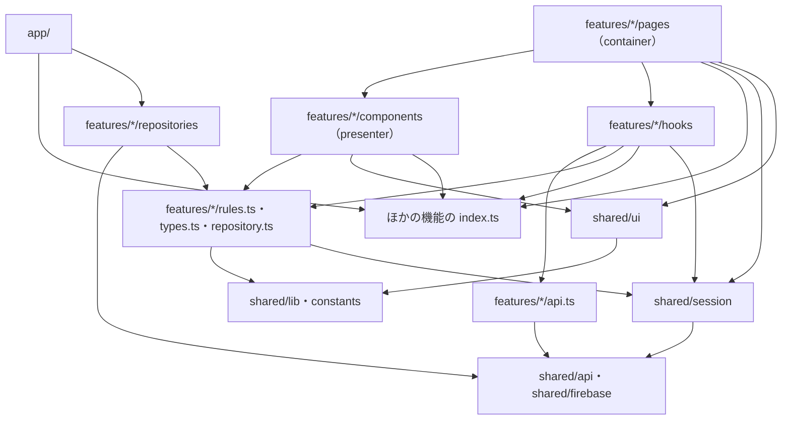

---
paths:
  - "frontend/*/src/**"
  - "frontend/*/biome.json"
---

# architecture-frontend（改訂版の画面）

改訂版（`refactored-repo`）の画面で、置き場・責務・依存の向きを決めるときの決まりと、書き方。会員の画面（`frontend/client`）と管理画面（`frontend/admin`）の両方に当てはめる。

- 形を選んだ理由（クリーンアーキテクチャの考え方を、どこまで採ったか）と、今のファイルをどこへ移すかの地図は [docs/frontend.md](../../docs/frontend.md)。決めたことは `docs/decisions.md` の D-018・D-026
- バックエンドの決まりは [architecture-backend.md](architecture-backend.md)。このファイルはバックエンドには当てはめない
- React・TypeScript・Biome の書き方は [quality-frontend.md](quality-frontend.md)
- レガシー版（1画面に1つの大きな部品）の書き方は、改訂版の新しいコードでは使わない

## 1. 迷ったときの判断の順

新しいコードを書くとき、上から順に当てはめ、最初に当たった場所に置く。

| 書くもの | 置き場 |
| --- | --- |
| ルートの表（パス・画面の題・どのタブを選ぶか）・ログインの守り・枠とタブ・どの画面にどの Repository の実装を渡すか | `app/` |
| ログインした自分（`Account` の型・`/api/me` を読む・読み直す・`useSession`） | `shared/session/` |
| API を呼ぶ・API の形を画面の形に変える | 機能の `api.ts`（Repository を作った機能では、Repository の実装） |
| 取る・持つ・中止・重なりを除く・失敗を状態に変える・二重に送らない・楽観的な表示を戻す | 機能の `hooks/` |
| 見せ方の決まり（年齢の下 ≤ 上・使える機能か） | 機能の `rules.ts`（純粋な関数） |
| props を受けて見せるだけ | 機能の `components/`（presenter） |
| hook・URL・ログインした自分をつなぎ、presenter に渡す | 機能の `pages/`（container） |
| どの機能にも属さない、見せるだけの部品・純粋な関数・定数（都道府県・プロフィールの選択肢・地方の区切り） | `shared/ui`・`shared/lib`・`shared/constants` |

## 2. ディレクトリと名前

```text
src/
├── app/            組み立て（router.tsx のルートの表・RequireAuth・AppShell・Provider）
├── features/<機能>/
│   ├── index.ts    ほかの機能と app/ に見せるものだけ
│   ├── pages/      container（いつも作る）
│   ├── components/ presenter（いつも作る）
│   ├── hooks/      手順と状態（要るときだけ）
│   ├── api.ts      API を呼ぶ＋形を変える（要るときだけ）
│   ├── types.ts    画面の型（要るときだけ）
│   ├── rules.ts    見せ方の決まり（決まりがあるときだけ）
│   ├── repository.ts・repositories/  データの出どころが2つある機能だけ
│   └── *.test.ts(x) テストは隣に置く
└── shared/
    ├── api/        client.ts（fetch の包み）・ApiError.ts
    ├── session/    ログインした自分
    ├── firebase/   Emulator への接続
    ├── ui/         見せるだけの部品・スクロールする枠の Context
    ├── lib/        純粋な関数（年齢の計算・uniqueBy）
    └── constants/  定数（都道府県の名前・プロフィールの選択肢）
```

- 機能の名前は、要件（`docs/requirements/`）のまとまりにそろえる。会員の画面の一覧は `docs/frontend.md` の「改善版の置き場」
- `pages/` と `components/` は、小さな機能でもいつも作る。import の決まりをフォルダの単位で書くため（平たく置くと、container と presenter を機械で見分けられない）
- 例外：画面をまだ移していない機能（今は下のタブの数だけの `messages`）は、`pages/`・`components/` を、画面を移すチケットで作る（container も presenter もまだないため。#247）
- ファイルの名前：container は `XxxPage.tsx`、presenter は `XxxView.tsx`（画面全体）か部品の名前、hook は `useXxx.ts`、API の形の型は `XxxResponse`、形を変える関数は `toXxx`
- 画面の題と、どのタブを選ぶかは、`app/router.tsx` のルートの表に1行で持たせる（画面を足すときに直すのは1か所。管理画面の `domains.tsx` と同じ形）
- `index.ts` が出してよいのは、次のものだけ
  - ページ（`app/` が使う）
  - ほかの機能が使う hook と、読み直す関数（例：未読の数を読み直す）
  - ほかの機能が使う presenter（例：会員のカード・有料の印）
  - API を呼ぶ部品（通報のダイアログ・有料の誘導のダイアログなど）
  - 型

### 言葉

- container
  - 意味：`pages/` の部品。hook・URL・ログインした自分をつなぎ、presenter に props で渡す。取るのも持つのも hook
  - 注意：JSX の中身の大部分を書かない
- presenter
  - 意味：`components/` の部品。props だけで見せる
  - 注意：参考にした記事の「Presenters」（API の形を変える関数）とは別の意味。そちらは `toXxx` と呼ぶ
- Repository
  - 意味：データの出どころ（REST・Firestore）を隠す型の約束（`repository.ts` の `XxxRepository`）と、その実装（`repositories/`）
  - 注意：バックエンドは Repository を使わない（D-025）
  - 注意：画面の Repository は DB とのやり取りではない
  - 注意：`Source`・`Adapter`・`Interface` とは呼ばない
- `shared/api/client.ts`
  - 意味：ブラウザの `fetch` を包む1つのファイル
  - 注意：バックエンドの Client（外のサービスを呼ぶクラス）とは別のもの。`frontend/client`（会員の画面）とも別

## 3. 依存の向き

下の一覧の「使ってよい」に書いたものだけを使う（一覧は、許すものを並べたものとして読む）。#114 で Biome の `noRestrictedImports`（`biome.json` の `overrides`）に書き、`npm run lint:rules` と CI で止める。Biome で書けない決まりが出たら、dependency-cruiser を足すかを決める。

- Biome は import の文字そのもので比べるので、規則はフォルダの名前で書く（`shared/api` から見た `shared/session` は `../session/session` なので `**/session/*`）。`**/shared/session/**` と書くと、同じ `shared/` の中の相対の import を止められない（#114 で確かめた）
- `fetch` を使ってよいのは `shared/api/client.ts` だけ。ほかは `noRestrictedGlobals` で止める（テストのファイルは外す）。`shared/firebase` は Firebase の SDK を使い、`fetch` は使わない
- 機能の中の `sessionStorage`・`localStorage` も、`noRestrictedGlobals` で止める。例外は、検索の条件を読み書きする `features/search/hooks/useSearchConditions.ts` の1か所（5章）
- `rules.ts`・`types.ts`・`repository.ts`・`shared/lib`・`shared/constants` の `window`・`document`・ストレージも、`noRestrictedGlobals` で止める
- `noRestrictedGlobals` は、あとの `overrides` が前の `options` を置き換える。そのため、場所ごとに止める名前を全部書く（`fetch` を何か所にも書いているのはこのため）
- API の失敗のクラス（`StoppedRequestError`・`UnauthorizedError`・`EmailUnverifiedError`・`MaintenanceError`。のちの `ApiError`）は、`shared/api/ApiError.ts` に置く。`shared/api` の中で、hook と container が読んでよいのは、このファイルだけ
- `app/` から機能を読むときは `features/<機能>` と書く。`features/<機能>/index` と書いても止まる
- 画面を移している間は、`app/`・`shared/` から、まだ移していないレガシー版のファイル（`src/components/*` など）を import してよい。そのファイルは、移すチケットで `shared/ui` か機能へ移す（例：`app/RequireAuth.tsx` が使う `components/AwaitingVerification.tsx`）

Biome で止められないもの（レビューで見る。#114 で確かめた）：

- 機能どうしが、互いの `index.ts` を import し合う形
- 機能の中から、ほかの機能の中のファイル（`../../likes/hooks/useX`）を直に import する形
- `window.fetch`・`globalThis.fetch`・`window.sessionStorage` のように、`window.` を付けて書く形（`noRestrictedGlobals` は、グローバルの名前をそのまま書いた所だけを見る）
- hook が JSX を返す形

- `app/`
  - 使ってよい：すべての機能の `index.ts`・`shared/`
  - 使ってはいけない（よくある間違い）：機能の中のファイルを直に import する・画面の中身を書く
- `features/*/pages/`
  - 使ってよい：自分の機能の `components/`・`hooks/`・`types.ts`・`rules.ts`
  - 使ってよい：ほかの機能の `index.ts`
  - 使ってよい：`shared/`（`shared/api`・`shared/firebase` を除く）
  - 使ってはいけない（よくある間違い）：`fetch`・`shared/api`（`ApiError.ts` を除く）・`api.ts`・`repositories/`
  - hook を通す。Repository の実装は `app/` から props で受け取る
- `features/*/components/`
  - 使ってよい：自分の機能の `types.ts`・`rules.ts`
  - 使ってよい：ほかの機能の `index.ts` が出した presenter
  - 使ってよい：`shared/ui`・`shared/lib`・`shared/constants`
  - 使ってよい：React（`useState` などの React の hook）・`<Link>`
  - 使ってはいけない（よくある間違い）：機能の `hooks/` フォルダ・`api.ts`・`shared/session`・store
  - 使ってはいけない（よくある間違い）：`useNavigate`・`useParams`・`useSearchParams`・`useToast`・`fetch`・`sessionStorage`
- `features/*/hooks/`
  - 使ってよい：自分の機能の `api.ts`・`repository.ts`・`types.ts`・`rules.ts`
  - 使ってよい：ほかの機能の `index.ts`（hook・型・読み直す関数）
  - 使ってよい：`shared/session`・`shared/lib`
  - 使ってはいけない（よくある間違い）：JSX を返す・`fetch`・`shared/api` を直接（`ApiError.ts` を除く）
- `features/*/api.ts`
  - 使ってよい：`shared/api`・自分の機能の `types.ts`・`shared/lib`
  - 使ってはいけない（よくある間違い）：React・hook・store
- `features/*/repositories/`
  - 使ってよい：`shared/api`・`shared/firebase`・自分の機能の `repository.ts`・`types.ts`・`shared/lib`
  - 使ってはいけない（よくある間違い）：React・hook・store
- `features/*/rules.ts`・`types.ts`・`repository.ts`
  - 使ってよい：`shared/lib`・`shared/constants`・`shared/session` の型
  - 使ってはいけない（よくある間違い）：React・API・ブラウザの機能（純粋な関数と型だけ）
- `shared/session/`
  - 使ってよい：`shared/api`・`shared/firebase`・`shared/lib`・React
  - 使ってはいけない（よくある間違い）：`features/`・`app/`
- `shared/api/`・`shared/firebase/`
  - 使ってよい：ブラウザの `fetch`（`shared/api/client.ts` だけ）・Firebase の SDK（`shared/firebase`）
  - 使ってはいけない（よくある間違い）：`features/`・`app/`・React
- `shared/ui/`
  - 使ってよい：`shared/lib`・React
  - 使ってはいけない（よくある間違い）：`features/`・`shared/api`・`shared/session`
- `shared/lib/`・`shared/constants/`
  - 使ってよい：なし
  - 使ってはいけない（よくある間違い）：React・ブラウザの機能

- 機能どうしで、互いの `index.ts` を import し合わない（例：`profile` が `likes` を使い、`likes` も `profile` を使う）。両方が要るものは、`shared/` に移すか、`app/` か container でつなぐ。Biome の `noRestrictedImports` では止められないので、レビューで見る（増えたら dependency-cruiser を考える）



- `app/` は、自分の機能のページも `index.ts` を通して使う（図の `app --> other`）
- 図にない矢印は書かない。`shared/` から `features/` への矢印はない

## 4. 書き方

### API を呼ぶ所

- API を呼ぶのは、`shared/api/client.ts` を通した各機能の `api.ts` だけ。Repository を作った機能では、Repository の実装が `api.ts` の受け持ち（`client.ts` を呼び、`toXxx` で形を変える）も持ち、`api.ts` は作らない
- API の形が画面の形と同じでも、必ず `api.ts` を通し、画面の型を返す
- API・Firestore の形（`XxxResponse`・ドキュメントの形）は、`api.ts` か Repository の実装の中で1回だけ画面の形に変える。その型を、このファイルの外へ出さない
- 送り先（`VITE_API_URL`）を読むのは `client.ts` だけ。セッションの Cookie を送る（`credentials: 'include'`）のと、書き込みに CSRF のトークン（`X-XSRF-TOKEN`）を付けるのも `client.ts` だけ（D-027）
- 同じ呼び出しが重なるとき（検索の連打）は、hook が `AbortController` で古い方を止める

### 401 と 403

- 401 の扱いを当てるのは、ログインしたあとの API だけ。ログイン・登録・メールの確認・パスワードの再設定の API には当てない（パスワードが違うときも 401 が返るので、画面に誤りの文を出す）。`client.ts` を呼ぶときに、当てないことを指定する
- 会員の認証はセッション（D-027）。取り替え用のトークン（`refresh`）はないので、送り直さない
- 401 なら、`shared/session` が自分の情報を消し、ポーリングを止め、ログインの画面へ移す
  - 決まり：`RequireAuth` が今の URL を覚え、ログインのあとに戻す。戻り先は、アプリの中のパス（`/` で始まり、`//` で始まらない）だけにする
  - 分かっている不具合：今は覚えない（FR-UI-011）
- 今のつなぎ方（#257・#259）
  - ログインしているかは、`shared/session/SessionProvider.tsx` が決める。起動のときに `GET /api/me` を1回読み、通るかで決める（Cookie は HttpOnly なので、画面からは読めない）
  - 401 なら、前の会員の画面の情報（前の検索の条件・前の JWT）を消し、「していない」にする。`code` が `account_suspended` なら、理由を持ち、`RequireAuth` が `/login?reason=account-suspended` へ移す
  - タブを開き直したとき（`visibilitychange`）に `GET /api/me` を読み直す。ほかのタブで別の会員がログインしていたら、画面を読み込み直す（Cookie はタブのあいだで共有するため）
  - 分かっている不具合：ログインが要らない画面（ログイン・登録）も、起動の `GET /api/me` を待ってから出る（PR #280 のレビューの A2）
  - 決まるまでは、`app/SessionGate.tsx` が「読み込み中…」を出す。401 でない失敗（500・つながらない・10秒の時間切れ）は、「読み込めませんでした」と、もう一度のボタンを出す
  - ログインの画面は、ログインの API のあとに `signIn()` を呼び、`GET /api/me` が通らなければ「ログインできませんでした。画面を読み込み直してください」を出す（Cookie が届いていない設定のとき）
  - ログインが要る画面は、`app/RequireAuth.tsx` の下に置き、画面ごとに確かめない
  - コードでは「自分」を `Me` と呼ばず、`Account` と呼ぶ（`docs/glossary.md` の「アカウント」）
  - `shared/api` は `shared/session` を使えないので、`app/configureApi.ts` が起動のときに、401 のときの動きを `configureApiClient()` で `client.ts` に渡す
  - ログインしたあとの API の 401・419 のとき、`client.ts` は応答の `code`（419 は `'csrf'`）を `app/` に渡して `UnauthorizedError` を投げる。`app/` は `shared/session` の `clearSession()` を呼び、理由を付けてログインの画面へ読み込み直す（FR-UI-100）
  - 書き込みが 419 なら、`client.ts` が CSRF のトークンをもらい直して、1回だけ送り直す（419 では何も変わっていないので、二重にならない）
  - 401 のときは、まだ読み込み直す形（`configureApi`）。読み込み直すので、ポーリングも止まる。画面の中で移す形にしたら、ポーリングを止めることを、はっきり書く
- ログアウトの手順は、`shared/session/useLogout.ts` の1か所に書く（ホーム・設定・確認待ちの画面が使う）。移る先とトーストは、呼ぶ画面が決める
  - `apiFetchForLogout` で呼ぶ（401 でも移らない）。応答を待ち、`204`・`401`・`419` のあとでだけ「していない」にする（サーバーのセッションが消えないと、Cookie が生きたままなので）
- メンテナンス中の 503（FR-MAINT-006）は、`client.ts` の3つの関数が見分け、`app/configureApi.ts` から渡された `onMaintenance` を呼ぶ。`app/MaintenanceGate.tsx` が、どの画面の代わりにも「ただいまメンテナンス中です」を出す（画面ごとに 503 を見分けない）
  - 続きを止める（`MaintenanceError` を投げる）のは `apiFetch` だけ。ログインが要らない API（`apiFetchWithoutLogin`）とログアウト（`apiFetchForLogout`）は、待たずに呼ぶ所があるので、投げずに応答を返す
  - 起動のときの `GET /api/me` が 503 を返すので、ログインしていない人にもメンテナンスの画面が出る
  - メンテナンスに入ったあとに、前に送った要求の 401 が届いても、ログインの画面へは移さない
  - 解けたかは、会員が読み込み直して確かめる。メンテナンスでセッションを全部消すので、解いたあとはログインの画面に移る（FR-MAINT-002）
- メールアドレスを確認していない会員の 403（`code: "email_unverified"`。FR-AUTH-021）は、`client.ts` が `EmailUnverifiedError` を投げて、呼んだ画面の続きを止める（画面は移さない）。確認を促すのは、`app/RequireAuth.tsx` が画面の代わりに出す「確認待ち」（`components/AwaitingVerification.tsx`）と、枠のいちばん上の帯（`VerifyBanner`。FR-UI-014）。画面で受け止めるときは、親の `StoppedRequestError` で見分ける
- 403 は、応答の `code` で見分ける（有料が要る・男性でない・確認していない・ブロック）。ステータスだけで「有料が要る」と読まない。API が `code` を返すまでは、誘導のダイアログを 403 で出さず、`plans/rules.ts` の判断で出す

### 失敗と読み込み中

- `client.ts` は、`res.ok` でない応答で `ApiError`（状態コード・`code`・メッセージ・入力の誤り）を投げる
- hook が返す状態は、次の形を基本にする：`{ status: 'loading' | 'error' | 'success', data, refreshing, moreError }`
  - `refreshing`：中身を出したまま取り直している（ポーリング・続きの読み込み）。スケルトンに戻さない
  - `moreError`：続きの読み込みだけが失敗した。一覧は残し、下に「もう一度」を出す
  - 中止（`AbortError`）では、状態を変えない
- presenter は、`shared/ui/AsyncView` で、読み込み中・失敗・空・中身を出し分ける。スケルトンは画面ごとのものを props で渡す（中身と形をそろえ、CLS を出さない。FR-UI-025）
- 失敗の JSON を、一覧として置かない

### 書き込み

- 書き込みの hook は、送っている間（`submitting`）は次を受け付けない。購入のように二重になると困る書き込みは、API の側でも二重を止めているかを確かめる
- 楽観的な表示（いいね・メッセージの送信）は、hook が送る側で id を作り、届いた本物と突き合わせて消す。失敗したら hook が戻す
- 書き込みのあとに、ほかの機能の数（未読・届いたいいね）が変わるときは、その機能の `index.ts` が出す「読み直す関数」を呼ぶ
- 購入が成功したあと、有料の機能の API が 403 を返したあとは、`shared/session` の読み直す関数を呼ぶ（使える機能が変わるため）

### 機能をまたぐ部品

- ほかの機能の、API を呼ぶ部品（例：トーク画面から開く通報のダイアログ）は、container（`pages/`）がほかの機能の `index.ts` から受け取り、`children` か props で presenter に渡す
- presenter は、ほかの機能の `index.ts` が出した presenter（会員のカード・有料の印など）だけを使ってよい
- 見せるだけの部品は、3つ目の機能が使うときに `shared/ui` へ移す。API を呼ぶ部品は `shared/` へ移さず、持ち主の機能の `index.ts` から出す

### 有料の出し分け

- 画面に `if (isPaid)` を書かない。`GET /api/me` が返す使える機能を、`plans/rules.ts` の1か所で判断する（FR-PAID-016・017）
- 画面の決まりは、見せ方を決めるだけ。断るのは API（403 など）

### A/B テスト・機能のフラグ

- 分けるのは container（`pages/`）だけ。presenter を差し替え、部品の奥に条件を書かない
- フラグを読む所は1か所に作る（要件に出てきたときに作る）

### 読み込みの大きさ

- Firestore の画面のルートは、`lazy()` で分けて読む（Firebase の SDK を、全員の最初の読み込みに入れない）。`app/router.tsx` は、Firestore の Repository の実装を直に import しない
- ほかの機能のルートを分けて読むかは、`vite build` の大きさと LCP を測ってから決める

## 5. 状態の置き場

くわしい決まりがあるものは、表の下の見出しに書く。

| 状態 | 置き場 |
| --- | --- |
| API から取ったデータ（一覧・詳細） | その機能の hook（`useState`）（くわしくは下） |
| 検索の条件 | 正は URL（`useSearchParams`）（くわしくは下） |
| ログインした自分（性別・使える機能） | `shared/session/`（くわしくは下） |
| 画面をまたぐ数 | その機能の hook（くわしくは下） |
| 楽観的な表示・送っている間 | その機能の hook |
| スクロールする枠 | `AppShell` が `shared/ui` の Context で渡す（`document.querySelector` で探さない） |
| トースト | `shared/ui/Toast`（Context） |
| メンテナンス中か | `app/maintenance.ts`（React の外の変数。`MaintenanceGate` が `useSyncExternalStore` で読む。`client.ts` の 503 から変えるので、React の外に置く） |
| 入力中の値 | hook か presenter（くわしくは下） |

### API から取ったデータ（一覧・詳細）

- その機能の hook（`useState`）に置く
- TanStack Query は使わない（D-005）
- 画面を離れたら捨てる。相手のプロフィールから戻ったときに、一覧のスクロールの位置は戻さない（今の動きと同じ）

### 検索の条件

- 正は URL（`useSearchParams`）
- URL にクエリがないとき（タブのリンクから開いたとき）だけ、sessionStorage の最後の条件に戻す（FR-UI-016・043）
- 読み書きは `useSearchConditions` の1か所
- フリーワードも URL に入るので、アクセスのログに残してよいかは、まだ確かめていない

### ログインした自分（性別・使える機能）

- `shared/session/` に置く（今は Context、05b で Zustand）
- `GET /api/me` を読むのは、起動したとき・購入が成功したとき・有料の機能で 403 が返ったとき
- ログアウトのときは消し、Firebase からも抜ける

### 画面をまたぐ数

未読の数・届いたいいねの数・管理画面のまだ対応していない通報の数。

- その機能の hook に置く（05b からは小さな store）
- 読み直す関数を `index.ts` から出す。#247（下のタブの数）では出していない。使う画面（トーク・いいね）を移すときに足す
- 数を読む部品は `TabBar`（管理画面はサイドバー）の中だけにし、描き直しをその部品にとどめる
- 数だけを返す API ができるまでは、今の読み方のまま、その機能の `api.ts` に移す。下のタブの未読・新しいマッチ・届いたいいねは、数だけを返す API（`GET /api/me/badge-counts`）を `features/messages` の `useBadgeCounts` が読む（#247）

### 入力中の値

- 失敗のときに戻す値（送れなかったメッセージ）は、hook が持つ
- ほかの所から入れる値（保存した条件・URL）も、hook が持つ
- presenter は `value` と `onChange` を受け取るだけ
- それ以外（ダイアログが開いているか、など）は presenter の `useState`

## 6. データの出どころが2つある機能（メッセージ）

- `MessageRepository` の約束は、次の形を基本にする：`subscribe(roomId, onChange, onError): () => void`・`loadOlder(roomId, before)`・`send(roomId, body)`
- 画面の `Message` は、`isMine`（自分が送ったか）と、`Date` の時刻を持つ。Laravel 版（中の id・ISO の文字）と Firestore 版（uid・Timestamp）の違いは、各実装の中だけで変える
- 片方にしかない機能（既読・送れるかの判断・ブロック・通報）は、約束に「あるか」（`features`）を持たせ、container がそれで出し分ける
- 失敗は、両方とも `ApiError` と同じ形の画面の失敗に変えて渡す（Firestore の `permission-denied` なども）
- Firebase へのログインは、Firestore の実装が最初に使うときに1回だけする。ログアウトのときに抜けるのは `shared/session`
- テストでは、メモリの上で保存する偽物の `MessageRepository` を渡し、同じテストを流す

## 7. テスト

| 何を | どう試すか | 置き場 |
| --- | --- | --- |
| `rules.ts`・`shared/lib` | Vitest の単体（境界値） | 隣の `*.test.ts` |
| `api.ts`・Repository の実装の変換 | `docs/api/` の応答の例を入れ、画面の形が出るか | 隣の `*.test.ts` |
| presenter | Testing Library。props を渡して、見えるものとボタンを確かめる（API なし） | 隣の `*.test.tsx` |
| hook | `api.ts` の関数（Repository を作った機能では、偽物の Repository）を差し替え、中止・重なり・失敗・二重に送らないことを確かめる | 隣の `use*.test.ts` |
| container | hook を偽物にして、URL と props のつなぎを確かめる | 隣の `*Page.test.tsx` |
| `RequireAuth`・`client.ts` | 401 で移ること・戻り先・`refresh` を1回だけ試すこと・500・204・中止 | `app/`・`shared/api/` の隣 |
| 移す前の今の動き | 画面の単位で、`fetch` を偽物にして書く（移したあとも、同じテストが書き換えずに通るように） | 移す画面の隣 |

- `api.ts`・Repository の実装の変換のテストに入れる応答の例は、`docs/api/` の改善版の列のもの
- API の形を変える PR では、同じ PR で例とこのテストを直す
- バックエンドの API テストでも、同じ形を確かめる

テストの種類と書き方は [testing.md](testing.md)・[testing-style.md](testing-style.md) に従う。E2E の道具は、まだ決めていない。

## 8. 共通の原則

バックエンドの [architecture-backend.md](architecture-backend.md) の9章と同じ考え方を、画面の言葉で書く。

### SSoT（1つの事実は1か所に）

- 年齢の計算・都道府県の名前・プロフィールの選択肢・使える機能の判断・入力の決まりを書く前に、`shared/lib`・`shared/constants`・各機能の `rules.ts` を検索して使う。見つからないときだけ新しく書く
- 共通にするのは同じ事実だけ。見た目が似ているだけの部品は、各機能に置いたままにする
- 画面の型は手で書く（D-006）。同じ API の型を2か所に書かない

### やりすぎない

- Repository は、データの出どころが2つあるとき、またはテストで外を偽物にしたいときだけ作る
- UseCase を React から外した純粋な関数にするのは、手順が込み入り、hook のテストが書きにくいときだけ
- 要件にない汎用の部品・設定・抽象化を足さない。起こりえない入力への防御を足さない

### 1ファイル1責務

- ファイルの担当を一文で言えること。「検索の条件を URL に読み書きする」は合格、「検索まわりいろいろ」は失格
- 部品が 150行を超えたら、presenter を分けるか、hook に出す

## 9. まだ移していない古いコード

- 画面を移すチケットでは、先にその画面の今の動きを確かめるテストを足し、それから移す
- 移す単位は、画面（ルート）1つ以上。移したら、古いファイルを消す
- 移すコミットと、振る舞いを変えるコミット（失敗の表示を足す・不具合を直す）を分ける
- 移していない画面のコードは、触る必要が出たときに移す。移さずに直すときは、そのチケットに理由を書く

## 10. やってはいけない書き方

- 部品の中で `fetch` を書く・`import.meta.env.VITE_API_URL` を読む・トークンを読む
- `res.ok` を見ずに、応答をそのまま状態に置く
- `any` を使う（代わりに何を書くかは [quality-frontend.md](quality-frontend.md) の T1・T2）
- API の形（snake_case・生年月日）を、`api.ts`・Repository の実装の外で読む
- ログインの守りを画面ごとに書く（`app/RequireAuth.tsx` の1か所）
- presenter の中で、機能の hook・`shared/session`・ルーターの hook を使う
- 画面の題・タブの選び方を、ルートの表の外に書く

## 11. 管理画面での当てはめ

- 同じ形にする（`app/`・`features/`・`shared/`）。`src/domains/` は `src/features/` に名前を変える（#123）
- サイドバーとルートを1つの表から作る今の形（`domains.tsx`）は、`app/features.tsx` としてそのまま使う。各機能のページは `index.ts` から import する
- ログインと役割（今は sessionStorage の `admin` から読む）は `features/auth/` と `shared/session/` に置き、役割の判断を画面ごとに書かない。断るのは API
- ヘッダーの会員の検索（`MemberSearch.tsx`）は、`members` の `index.ts` から `AppShell` に出す
- まだ対応していない通報の数は、5章の「画面をまたぐ数」と同じに扱う
- 見た目の部品は Mantine をそのまま使う（`shared/ui` で包み直さない。包むのは、同じ組み合わせを3か所で使ったとき）
- 書き込み（停止・解除など）には、確かめのダイアログと失敗の表示を必ず付ける
- `Notice.tsx`・`Icon.tsx`・`date.ts` と `domains/members/paid.tsx` の置き場は、#123 で決める
