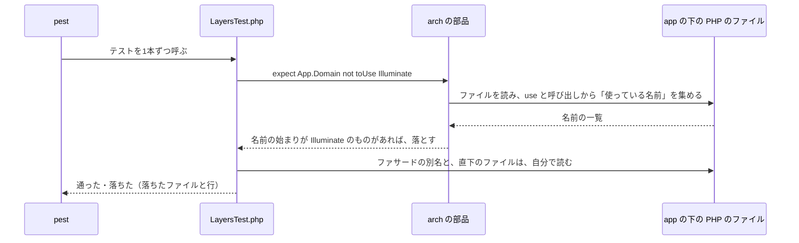
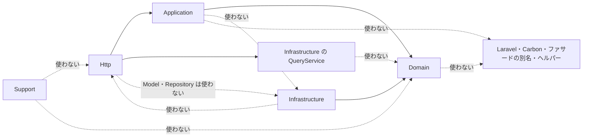
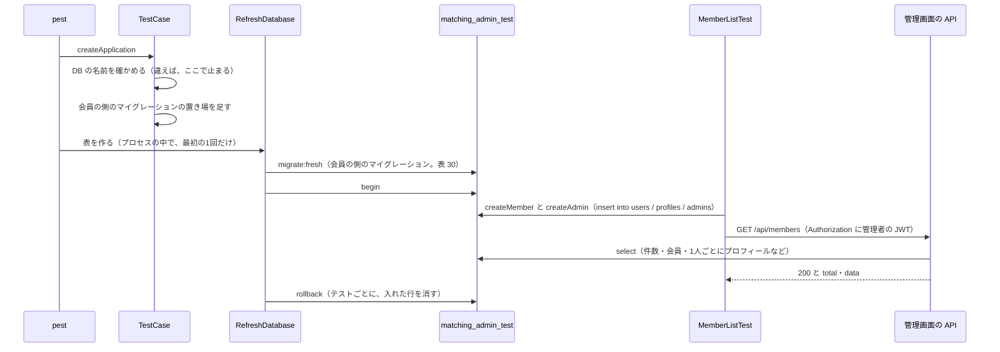
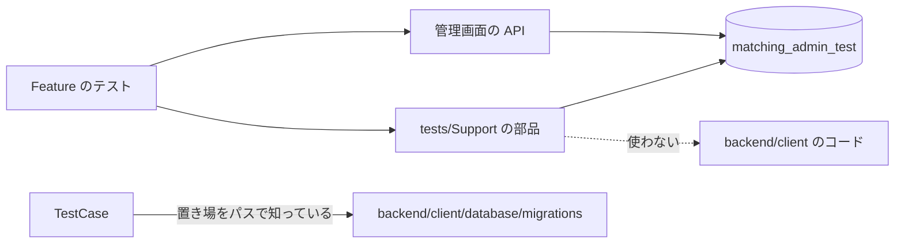
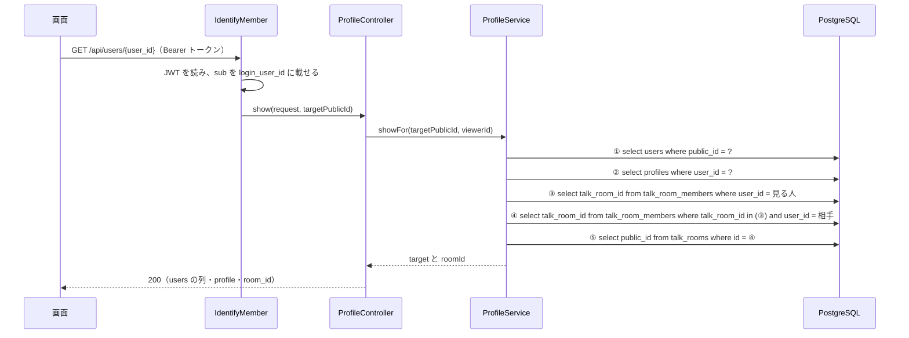
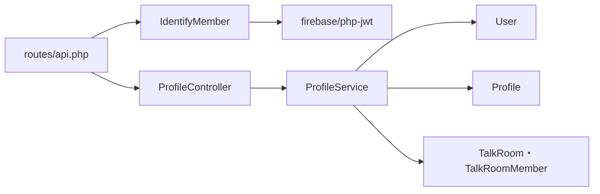

# コードの解説

PR ごとに1節。形は process.md の6章。

## PR #

### ディレクトリの設計

### クラスの責務

### メソッドの表

| メソッド | 入力 | 戻り値 | 副作用 | 失敗のしかた | 呼ぶ所 |
| --- | --- | --- | --- | --- | --- |
| | | | | | |

### 呼び出しの流れ

### 名前・依存の向き

### レガシー版との違い

### 説明の練習

## PR #231（#106 アーキテクチャのテスト。会員の側）

アプリのコードは変えていない。層の決まり（`agents/rules/architecture.md` の2章・3章）を、機械で確かめるテストを足した。クラスもメソッドも足していないので、「クラスの責務」「メソッドの表」は、テストごとの表に読み替える。

### ディレクトリの設計

```text
backend/client/tests/
├── Arch/
│   └── LayersTest.php   ← 足した。層の決まりを確かめるテスト 15本
├── Feature/             （前から。DB と API をまたぐテスト）
├── Unit/                （前から。まだ空）
└── Support/             （前から。テストの部品。#104）
```

- 置き場の理由：`architecture.md` の8章が、`tests/Arch/LayersTest.php` と決めている。`phpunit.xml` の `Arch` の組（`tests/Arch`）は、前からあった
- ほかに置ける場所と、置かなかった理由
  - `tests/Unit`：DB を使わないので、置けなくはない。ただ、Unit は「業務の決まり（Domain）を、値を渡して確かめる」場所にしたい。層の決まりは、アプリの振る舞いではなく、コードの形の確かめなので、分けた
  - Larastan の独自のルール：書けるが、ルールを PHP のクラスで書くことになり、読むのも直すのも重い。Pest は、もう入っている
  - deptrac：依存の図が出るが、道具が1つ増える（チケット #106 の「候補の比較」で、採らなかった）
- `Arch` の組は、`Feature` と違い、`RefreshDatabase` を使わない（`tests/Pest.php` で、DB の準備を付けているのは `Feature` だけ）。DB がなくても流せる

### テストごとの表（「クラスの責務」「メソッドの表」の代わり）

決まりを1行ずつ。「どう確かめるか」は2通りある：`arch()`（Pest の部品。PHP のファイルを読んで、だれがだれを使うかを調べる）と、ファイルの文字や名前を自分で読むテスト。

| テスト | 何を確かめるか | どう確かめるか | 落ちる例 |
| --- | --- | --- | --- |
| Domain はほかの層・Laravel・Carbon・基盤を使わない | Domain は、PHP の標準だけ | `arch()` | Domain に `use Illuminate\Support\Facades\DB;` |
| Application は Http・Infrastructure・Laravel・Carbon・基盤を使わない | UseCase は、Domain だけを使う | `arch()` | UseCase に `use App\Infrastructure\Repositories\…;` |
| Domain／Application は Laravel のヘルパー関数を使わない（2本） | `now()`・`config()`・`resolve()` など | `arch()` | Domain に `now()` |
| Domain と Application は、ファサードの別名を使わない | `\DB::`・`use DB;`・`use DB as X;`・`use Log, DB;` | ファイルの文字を読む | Domain に `\DB::table(…)` |
| Http が使ってよい Infrastructure は QueryService だけ | 新しい Controller は、Model・Repository を直接使わない | `arch()`。古いコントローラー 19個は外す | 新しい Controller に `use App\Models\User;` |
| app/Http/Controllers の直下には、基底と古いコントローラーだけがある | 直下に、新しいコントローラーを足さない | フォルダのファイルの名前を、一覧と比べる | 直下に `UserControllerV2.php` |
| Infrastructure は UseCase と Http を使わない | Repository は、呼ぶ側を知らない | `arch()` | Repository に `use App\Http\…;` |
| QueryService は Application・Repository・Domain を使わない | 読み取りの道は、書き込みの道と交わらない | `arch()` | QueryService の引数の型が Domain の値オブジェクト |
| Support（基盤）は、層と Model を使わない | 基盤は、機能を知らない | `arch()` | Support に `use App\Models\User;` |
| Domain の interface は Interface で終わる・UseCase は final・UseCase で終わる・QueryService は final（4本） | 名前と `final` | `arch()` | `class LikeUseCase`（`final` がない） |
| 新しい層のファイルは strict_types | `declare(strict_types=1);` | `arch()`。古いコントローラーは外す | `declare` のないファイル |

大事な所の抜き出し（3か所）。

①「まだ移していないもの」の一覧。この一覧が、そのまま移行の残りになる。

```php
const LEGACY_CONTROLLERS = [
    'App\Http\Controllers\AuthController',
    // …（19個）
];
const LEGACY_MODELS = 'App\Models';   // ignoring には渡さない
```

② `ignoring` に渡すのは、古いコントローラーだけ。`App\Models` を渡すと、新しいコードが Model を使っても落ちなくなる（`ignoring` は、「使われる側」の名前も消すため）。

```php
arch('Http が使ってよい Infrastructure は QueryService だけ', function (): void {
    expect('App\Http')
        ->not->toUse([/* … */ LEGACY_MODELS])
        ->ignoring(LEGACY_CONTROLLERS);
});
```

③ ファサードの別名は、`arch()` では確かめられない。ファイルの文字を読む。

```php
// ① \DB:: のように、先頭に \ を付けて呼ぶ形
preg_match_all('/(?<![\w\\\\])\\\\('.$pattern.')\b(?!\\\\)/', $source, $calls);
// ② use で読み込む形。文を1つずつに分けて、名前を比べる
foreach (explode(',', $statement) as $part) {
    $imported = ltrim(trim((string) preg_replace('/\s+as\s+\w+\s*$/i', '', trim($part))), '\\');
    if (in_array($imported, $aliases, true)) { /* 違反 */ }
}
```

### 呼び出しの流れ

リクエストは来ない（アプリを動かさない）。テストを流したときの流れ。SQL は1本も流れない。



### 名前

| 名前 | 理由 | ほかの候補と、選ばなかった理由 |
| --- | --- | --- |
| `LayersTest` | 層（layer）の決まりを確かめる。8章が決めた名前 | `ArchitectureTest`：フォルダの名前（`Arch`）と重なる |
| `LEGACY_CONTROLLERS`・`LEGACY_MODELS` | 「古い」ではなく、「まだ移していない」という意味。移したら消す、が読み取れる | `IGNORED_…`：なぜ外すのかが、名前から分からない |
| `OUTSIDE_LAYERS` | 設計の図（3章）の層の外にあるフォルダ（`App\Mail`・`App\Providers`） | `LEGACY_FOLDERS`：`Providers` は古いものではなく、ずっと残る |
| `LARAVEL_HELPERS` | Laravel のヘルパー関数。Domain と Application で使わないもの | `FORBIDDEN_FUNCTIONS`：Http と Infrastructure では使ってよいので、「禁止」は言いすぎ |
| テストの名前（日本語の文） | 落ちたときに、どの決まりを破ったかが、そのまま読める | 英語の名前：決まりの文（2章の表）と、言葉がずれる |

### 依存の向き

テストが確かめている向き（2章の図）。実線は、使ってよい。点線は、テストが止めている向き。



テストのファイルそのものは、アプリのどのクラスも `use` していない（名前を文字として持つだけ）。使っているのは、Pest と、Laravel の `Facade::defaultAliases()`（別名の一覧を取るため）だけ。

### レガシー版との違い

レガシー版（`legacy-repo`）には、このテストがない（`tests/Arch` は、空のフォルダだった）。層の決まりを確かめる仕組みは、何もなかった。

| | レガシー版 | この PR のあと |
| --- | --- | --- |
| 層の決まり | ない（Controller に、JWT の読み出し・DB の読み書き・判断を、全部書く） | 文書（`architecture.md`）と、テスト 15本 |
| 古いコントローラー | 19個（2026-11-17〜18 に、通報・お知らせなどで増えた） | 19個のまま。一覧（`LEGACY_CONTROLLERS`）に並び、移した分だけ、一覧から消す |
| 新しいコントローラーを足す場所 | `app/Http/Controllers` の直下 | 直下には足せない（テストが落ちる）。業務のまとまりのフォルダに足す |

### 作る途中で分かったこと（8章を直した所）

| 分かったこと | どうやって分かったか | 直し方 |
| --- | --- | --- |
| `expect(関数の一覧)->not->toBeUsedIn(層の一覧)` は、違反があっても通る | Domain に `now()` を置いて流した | 層ごとに `not->toUse(関数の一覧)` |
| `arch('名前')->expect(…)` は、Larastan が指摘する | Larastan を流した（テストのフォルダも対象） | 無名関数の中に書く |
| `arch()` は、名前の始まりで比べる | ライブラリのコードを読んだ（`leaveByNameStart`） | ファサードの別名と、直下のファイルは、完全に一致で比べるテストを別に書いた |
| 最初に書いた正規表現は、`use DB as Database;`・`use Log, DB;` を見逃した | 2回目のレビューで、レビュー役が置いて確かめた | `use` の文を1つずつに分けて、名前を比べる |

どれも、「テストが通った」だけでは分からなかった。新しい層にファイルがないあいだは、当てはまるものがなく、効いていないテストも通る。**違反を置いて、落ちるのを見る**ことで分かった。

### 説明の練習

（これから。人が説明したら、ここと `docs/onboarding/quiz-log.md` に残す）

## PR #232（#105 管理画面の API テストの土台と CI）

アプリのコード（`backend/admin/app`）は変えていない。管理画面のテストを、会員の側と同じ土台（Pest・本物の PostgreSQL・違う DB なら止める・部品）にした。

### ディレクトリの設計

```text
backend/admin/
├── composer.json・composer.lock   ← Pest を足した（会員の側と同じ版）
├── phpunit.xml                    ← DB を、SQLite のメモリ DB から、PostgreSQL の matching_admin_test に
└── tests/
    ├── TestCase.php               ← 違う DB なら止める。会員の側のマイグレーションの置き場を足す
    ├── Pest.php                   ← 足した。Feature に、TestCase と RefreshDatabase を付ける
    ├── Support/                   ← 足した。テストの部品
    │   ├── functions.php          （createAdmin・createMember・actingAsAdmin・adminToken）
    │   ├── TestAdmin.php          （createAdmin の返り値）
    │   └── TestMember.php         （createMember の返り値）
    └── Feature/
        ├── HealthTest.php         ← 足した。土台が、アプリを立ち上げられること
        ├── MemberListTest.php     ← 足した。見本の API テスト（会員の一覧）
        └── Support/SupportFunctionsTest.php   ← 足した。部品のテスト
docker/db/init/02-create-admin-test-db.sql   ← 足した。matching_admin_test を作る
.github/workflows/admin-backend.yml          ← テストの仕事を足した
```

- 置き場の理由：会員の側（`backend/client/tests/`）と、同じ並びにした（`agents/rules/testing.md`）。片方を知っていれば、もう片方も読める
- **表の作り（マイグレーション）は、管理画面に置かない。** 正本は `backend/client/database/migrations` の1か所で、テストのときに、そこを指して表を作る（`03-how.md` の案 A）
- ほかに置ける場所と、置かなかった理由
  - マイグレーションを管理画面にコピーする（案 C）：管理画面だけで閉じるが、正本が2つになり、ずれる
  - 会員の側と同じ DB（`matching_test`）を使う（案 B）：準備は少ないが、2つのテストを同時に流すと、表の作り直しがぶつかる
  - 部品を、2つのアプリで共有する：管理画面は、会員の側のコードを読み込まない決まり（12 の解説）。なので、同じ名前の部品が2つある

### クラスの責務

| クラス・ファイル | 知っていること | すること | しないこと |
| --- | --- | --- | --- |
| `Tests\TestCase` | テスト用の DB の名前（`matching_admin_test`）・会員の側のマイグレーションの置き場 | 違う DB なら、表を触る前に止める。マイグレーションの読み込み先を足す | 表を作る・巻き戻す（`RefreshDatabase` の仕事） |
| `tests/Support/functions.php` | 表の列と、行の形（退会のときのメールアドレスの書き換え など）・管理者の JWT の中身 | 管理者・会員の行を入れる。ログインした状態にする | 購入・停止の履歴・いいね・マッチ・メッセージ・監査ログを作る。API を呼ぶ |
| `TestAdmin`・`TestMember` | 作った行の、テストで使う値（ID・役割・`public_id`・メールアドレス・性別） | 値を運ぶだけ（`readonly`） | DB を読む・書く |

### メソッドの表

| 関数 | 入力 | 戻り値 | 副作用 | 失敗のしかた | 呼ぶ所 |
| --- | --- | --- | --- | --- | --- |
| `createAdmin()` | 役割（既定は `owner`）・名前（既定は「テスト管理者」） | `TestAdmin` | `admins` に1行 | 役割が `owner`・`viewer` 以外なら `InvalidArgumentException`（行を入れる前） | テスト |
| `createMember()` | 性別・有料・退会・停止・ニックネーム | `TestMember` | `users` に1行・`profiles` に1行 | 性別が `male`・`female` 以外・ニックネームが空の文字なら `InvalidArgumentException`（行を入れる前） | テスト |
| `actingAsAdmin()` | `TestAdmin` | テストの入口（`->getJson(…)` と続ける） | `Authorization` ヘッダーを付ける | ― | テスト |
| `adminToken()` | `TestAdmin` | JWT の文字 | なし | 鍵が空・短いと、ライブラリが例外を出す（`Provided key is too short`） | `actingAsAdmin()`。期限切れを試すテストは、使わずに自分で作る |
| `TestCase::createApplication()` | ― | アプリ | マイグレーションの読み込み先を足す | DB が `pgsql`・`matching_admin_test` でなければ `RuntimeException`。会員の側のマイグレーションの置き場がなければ `RuntimeException` | テストごとに、Laravel が呼ぶ |

大事な所の抜き出し（3か所）。

① 違う DB なら、表を触る前に止める。会員の側のテスト用（`matching_test`）でも止める。

```php
if ($connection !== 'pgsql' || $database !== 'matching_admin_test') {
    throw new RuntimeException("管理画面のテストは、テスト用の DB（pgsql・matching_admin_test）だけで動かす。…");
}
```

② 表は、会員の側のマイグレーションで作る。`migrate:fresh` が読む置き場に、足す。

```php
$app->afterResolving('migrator', static function (Migrator $migrator) use ($path): void {
    $migrator->path($path);   // $path は backend/client/database/migrations
});
```

③ 部品は、表に直接入れる（管理画面は Model を持たない）。決まっていない値は、入れる前に止める。

```php
if (! in_array($role, ['owner', 'viewer'], true)) {
    throw new InvalidArgumentException("createAdmin() の役割は owner か viewer。渡された値：{$role}");
}
$id = DB::table('admins')->insertGetId([/* … */]);
```

### 呼び出しの流れ

見本のテスト（会員の一覧）を1本流したとき。



### 名前

| 名前 | 理由 | ほかの候補と、選ばなかった理由 |
| --- | --- | --- |
| `matching_admin_test` | 会員の側の `matching_test` に、だれのテストかを足した | `matching_test_admin`：`matching_test` で始まるので、名前の始まりで比べる確かめがあると、取りちがえる |
| `createAdmin()`・`createMember()`・`actingAsAdmin()` | 会員の側の部品（`createMember()`・`actingAsMember()`）と、言い方をそろえた | `makeAdmin()`：Laravel の Factory では、`make` は「DB に入れない」の意味 |
| `adminToken()` | 会員の側の `memberToken()` と対 | `jwt()`：だれのトークンかが、名前から分からない |
| `TestAdmin`・`TestMember` | テストで作ったもの、と分かる。アプリの Model ではない | `Admin`・`Member`：あとで作る Domain のクラスと、名前がぶつかる |

### 依存の向き



管理画面のテストが、会員の側について知っているのは、マイグレーションの置き場のパスだけ（PHP のクラスは、読み込まない）。置き場を動かすと、`TestCase` の1行を直す。

### レガシー版との違い

| | レガシー版（`legacy-repo`） | この PR のあと |
| --- | --- | --- |
| テストの DB | SQLite のメモリ DB。マイグレーションがないので、表のない DB で走る | PostgreSQL の `matching_admin_test`。表は、会員の側のマイグレーションで 30 |
| テストの道具 | PHPUnit だけ | Pest（会員の側と同じ版） |
| テスト | 0本 | 18本（土台 1・見本 3・部品 14） |
| CI | 整形と静的解析だけ | テストも流れる |

### 作る途中で分かったこと

| 分かったこと | どうやって分かったか | 直し方 |
| --- | --- | --- |
| ライブラリを入れるとき、範囲を絞らないと、Laravel 本体まで上がる | 入れたあとの差分を見た | Pest と PHPUnit だけを指定して入れ直した。一緒に上がった1つ（`symfony/polyfill-php85`）も、レビューのあとに戻した |
| `$this->getJson()` は、Larastan が指摘する | Larastan を流した | 会員の側と同じく、`Pest\Laravel\getJson` の関数で呼ぶ |
| 部品に、決まっていない役割や性別が、そのまま入る | レビュー。表に、止める制約がない | 部品の入り口で止める |
| 表に直接入れる部品は、会員の側の表が変わっても、気づけない | レビュー | 部品が行を入れる表の、列の名前の一覧を、テストに書いた |

### 説明の練習

（これから。人が説明したら、ここと `docs/onboarding/quiz-log.md` に残す）

## PR #239（#236 設計の決まりを Controller → Service → Model に）

コードは変えていない（決まりとアーキテクチャのテストだけ）。解説の本体は `agents/rules/architecture.md` の4章（見本）と、`docs/backend.md` の3章（移行の地図）。

### 説明の練習

リーダーが「自分のプロフィールのニックネームを直す API を、新しい形で作るとき、どのファイルに何を書くか」と聞いた（2026-11-19）。

| 問い | 人の答え | 結果 |
| --- | --- | --- |
| 通るファイルと仕事 | 最初はレガシー版の形（Controller にロジックと保存）。ヒントのあと、Middleware・Request・Service・Model・Resource の仕事を5つとも合わせた | 一部（ヒント1） |
| 「空にできない」の置き場 | Service | ずれた（正しくは Request。値1つで決まる入力の形・422） |
| `PATCH /me` で他人を直せない理由 | Middleware で判断する | 一部（URL に相手の ID がないこと、が足りない） |

- 次にやること：#237 で実物を作ったあとに、同じ流れをヒントなしで説明する

## PR #240（#237 ホームのプロフィールの API を Service に移す）

`GET`・`PUT /api/users/{user_id}` を、レガシー版の `ProfileController`（55行）から、Controller → Service → Model の形に移した。動きは変えていない。

### ディレクトリの設計

```text
backend/client/
├── app/
│   ├── Http/
│   │   ├── Controllers/Profile/ProfileController.php   新しい Controller（直下の古いものは消した）
│   │   └── Middleware/IdentifyMember.php               トークンがあれば、ログインしている人を載せる
│   └── Services/Profile/ProfileService.php             読む・探す・書き換える
└── tests/
    ├── DummyData/                                      テストの会員・マッチ・トークンを作るクラス
    └── Feature/Profile/ShowTest.php・UpdateTest.php    今の動きを確かめる API テスト
```

| 置いた所 | 理由（`architecture.md`） | ほかに置ける所と、置かなかった理由 |
| --- | --- | --- |
| `Profile/` のフォルダ | 3章：置き場の中を業務のまとまりで分ける。プロフィールは `Profile`（`docs/backend.md` の2章） | `Members/`：会員の検索・通報なども入り、何のまとまりか分かりにくい（人が決めた） |
| `IdentifyMember`（Middleware） | 4章：トークンを読むのは Middleware だけ | Controller で読む（レガシー版の形。29か所のコピーと同じ形が、もう1つ増える）・Service で読む（Service は HTTP を知らない） |
| Resource を作らない | 4章：返す項目を選ぶときに作る。今は全部の列を返すので、作っても中身がない | `ProfileResource` を作り、`toArray()` をそのまま返す（作ったあと、中身がないので消した） |

### クラスの責務

| クラス | 責務 |
| --- | --- |
| `ProfileController` | URL の `{user_id}` とリクエストを知っていて、Service を呼んで JSON にする。DB と JWT は知らない |
| `ProfileService` | 会員とプロフィールの読み方・2人のトークルームの探し方・書き換え方を知っていて、Model を呼ぶ。HTTP（リクエスト・状態コード）は知らない |
| `IdentifyMember` | JWT の読み方を知っていて、ログインしている人の `users.id` を `login_user_id` に載せる。トークンがなくても止めない。会員が使えるか（退会・停止）は見ない |

### メソッドの表

| メソッド | 入力 | 戻り値 | 副作用 | 失敗のしかた | 呼ぶ所 |
| --- | --- | --- | --- | --- | --- |
| `ProfileService::showFor` | `$targetPublicId`（UUID）・`$viewerId`（`users.id` か null） | `array{target: User, roomId: string\|null}` | なし（読むだけ） | いない会員：`firstOrFail()` の例外 → 404（文に Model の名前が出る）。UUID の形でない：PostgreSQL のエラー → 500 | `ProfileController::show` |
| `ProfileService::update` | `$targetPublicId`・`$input`（送られた項目の全部） | 書き換えた `Profile` | `profiles` の1行を書き換える | いない会員・プロフィールがない：`RuntimeException` → 500 | `ProfileController::update` |
| `ProfileController::show` | `Request`・`$targetPublicId` | JSON（`users` の列・`profile`・`room_id`） | なし | Service の例外がそのまま上がる | ルート `GET /api/users/{user_id}` |
| `ProfileController::update` | `Request`・`$targetPublicId` | JSON（`profiles` の列） | Service と同じ | 同上 | ルート `PUT /api/users/{user_id}` |
| `IdentifyMember::handle` | `Request`・次の処理 | 次の処理の応答 | `login_user_id` を載せる | 壊れた・期限の切れたトークン：JWT の例外 → 500 | ルートの `->middleware('member.identify')` |

見る人がいるときだけ、トークルームを探す（`ProfileService.php`）：

```php
$target = User::query()->where('public_id', $targetPublicId)->firstOrFail();
$target->load('profile');

return [
    'target' => $target,
    'roomId' => $viewerId === null ? null : $this->findSharedRoomId($viewerId, $target->id),
];
```

外の番号（UUID）を、中の番号（`users.id`）に置き換えてから、プロフィールを探す（`ProfileService.php`）：

```php
$targetId = User::query()->where('public_id', $targetPublicId)->value('id');
$profile = Profile::query()->where('user_id', $targetId)->first()
    ?? throw new RuntimeException('プロフィールが見つからない');
$profile->update($input);
```

HTTP の側の名前（`$loginUserId`）から、業務の側の名前（`$viewerId`）に渡す（`ProfileController.php`）：

```php
$loginUserId = $request->attributes->get('login_user_id');   // IdentifyMember が載せる。トークンがなければ null
$result = $this->profiles->showFor($targetPublicId, is_int($loginUserId) ? $loginUserId : null);
```

### 呼び出しの流れ

ログインしている人が、相手のプロフィールを見るとき（SQL 5本）。



トークンがないときは、`IdentifyMember` が何も載せず、①②の2本だけになる。書き換えは、`users` の `id` → `profiles` を1件 → `update profiles` の3本。

### 名前

| 名前 | ほかの候補 | 選ばなかった理由 |
| --- | --- | --- |
| URL の `{user_id}` | `{publicId}`（前の名前） | 用語集の「ID の名前」の決まり（2026-11-16）と違う |
| `$targetPublicId`・`$targetId` | `$publicId`・`$memberId` | 「だれの」「どちらの番号か」が分からず、読み違えた（用語集の「コードの中の、会員の番号の名前」） |
| `login_user_id`・`$loginUserId` | `member_id`・`viewer_id` | `member_id` は用語集では管理画面の UUID。`viewer_id` は、書き換えの API で使うと意味が合わない |
| `$viewerId`（Service） | `$loginUserId` | Service は HTTP を知らない。コマンドから呼ぶときも「見る人」なら通じる |
| `showFor` | `show`・`showMine` | Controller の名前とそろえない（3章）。`Mine` は自分のものだけ。相手のものも見るので `For`（だれに向けて見せるか） |
| `IdentifyMember` | `AuthenticateMember` | 認証（通さない）はしない。だれかを見分けるだけ。`AuthenticateMember` は、401 を返す Middleware の名前に取っておく |

### 依存の向き



逆向き（Model → Service、Service → Http）はない。`tests/Arch/LayersTest.php` が確かめる。`IdentifyMember` は、決まりの「Middleware → Service」をまだ使っていない（使えるかを見ないため）。

### レガシー版との違い

| | レガシー版（`legacy-repo`） | この PR のあと |
| --- | --- | --- |
| 置き場 | `ProfileController` の1ファイル（55行）に、JWT・SQL 5本・書き換えが全部 | Middleware（JWT）・Controller（受け取る・返す）・Service（SQL と書き換え）の3つ |
| トークンを読む所 | `show` の中（`if ($token)`） | `IdentifyMember`（`$token !== null && $token !== ''`） |
| テスト | 0本 | 14本（見る 8・書き換え 6） |
| 応答・状態コード・SQL の本数 | ― | 同じ（テストを変えずに通る。SQL は 2・5・3本で同じ） |

移して、細かく動きが変わる所が2つある（どちらも、テストでは確かめていない。`pr-review` で見てもらう）。

- トークンが `0` という文字のとき：レガシー版は `if ($token)` で「ない」と見て 200。今は読もうとして、JWT の例外で 500
- 正しく署名したトークンの `sub` が数字でないとき：レガシー版は、そのまま SQL に入れて 500。今は「ログインしていない」と見て 200（`room_id` は null）。この API が作るトークンの `sub` は、いつも数字

### 直した課題と、現場での意味

`05-problems.md` には、まだこのチケットの節がない（課題の理解は会話の中で行い、記録していない。あとで書く）。

- だれが困らなくなるか：次にプロフィールの不具合（見せすぎ・他人の書き換え）を直す人。どこに何があるかが分かれ、テストが14本あるので、直したら落ちる・通るで確かめられる
- どう気づけるようになるか：分かっている不具合が、テストとコードのコメントに書いてある。直すときは、そのテストを要件どおりに戻せば落ちる
- 数字：テスト 0 → 14本。SQL の本数は前と後で同じ（2・5・3本）

### 次の改善の候補

どれも、このチケットでは直さない（動きを変えずに移すチケットのため）。直すときは、テストの「分かっている不具合」を要件どおりに戻し、落ちる（Red）のを見てから直す。

| 候補 | 今どうなっているか | 直すとどうなるか | 気づいた所 |
| --- | --- | --- | --- |
| トークルームを探す SQL を1本にする | `ProfileService::findSharedRoomId` が、自分のルームの一覧 → 相手もいるルーム → ルームの番号、の3本を流す | `talk_room_members` を2回つなぐ（JOIN）1本で探せる。ログインして見ると5本が3本になる | 前と後の SQL の本数を測ったとき |
| 2人のルームを探す条件を、Model のスコープにする | `whereIn('talk_room_id', …)->where('user_id', …)` を Service に直接書いている | トークの API でも同じ条件を使うので、`TalkRoomMember` の1か所にまとめられる | Service に移したとき |
| 返す項目を選ぶ（FR-002） | `toArray()` で、メールアドレスなども全部返す | Resource を作り、返してよい項目だけにする（`architecture.md` の Resource の決まり） | 今の動きを確かめるテスト |
| 入力を確かめる（FR-010・FR-006） | `$request->all()` を、そのまま `fill()` に渡す | Form Request の `validated()` だけを渡す。空のニックネームは 422 | 今の動きを確かめるテスト |
| 他人のプロフィールを書き換えられないようにする（FR-AUTH-022） | PUT のルートに、ログインを求める Middleware がない | ログインを求め、URL の会員が自分でなければ 403 | 今の動きを確かめるテスト・Bruno |
| 壊れたトークンを 401 にする | `IdentifyMember` が、JWT の例外のまま 500 を返す | 例外を受けて 401 を返す。トークンを読むコード（17のコントローラーに29か所）も、Middleware にまとめる | Middleware を作ったとき |
| 見つからないときの応答をそろえる | GET は Laravel の 404（文に Model の名前が出る）、PUT は 500 | どちらも、決まった形の 404 にする（`architecture.md` の7章） | 今の動きを確かめるテスト |

### 説明の練習

リーダーが、問い合わせの場面で聞いた（2026-11-19）：「マッチしている相手のプロフィールを開いたのに、『メッセージを送る』のボタンが出ない」（画面は、`room_id` が null だとボタンを出さない）。

| 問い | 人の答え | 結果 |
| --- | --- | --- |
| 通るコードの順 | ルート → `IdentifyMember` → `ProfileController` → `ProfileService` | 合っている |
| 見る人の番号の渡り方 | トークンの `sub` → Controller は `$loginUserId` → Service は `$viewerId`（ヒント1） | 合っている。あいだは `$request->attributes` の `login_user_id` |
| `room_id` が null になる所 | トークンがないとき・トークルームの行がないとき（ヒント1） | 合っている。ほかに、`sub` が数字でないとき・`talk_room_members` に片方の行しかないとき |
| それを確かめているテスト | 「マッチしていない相手なら、room_id は null」と「マッチしている相手なら、room_id に…入る」 | 一部。「トークンがない」の場面は、どのテストも `room_id` を確かめていない（「200 で見られる」は状態コードだけ） |

- 分かったこと：チケットの「今の動きを確かめるテスト」の一覧にあった「トークンなしなら `room_id` は null」が、テストに入っていなかった
- 次にやること：テストの名前だけでなく、確かめている行（`assert…`）まで見る

