# コードの解説

PR ごとに1節。形は process.md の6章。

## PR #

### ディレクトリの設計

### クラスの責務

### メソッドの表

| メソッド | 入力 | 戻り値 | 副作用 | 失敗のしかた | 呼ぶ所 |
| --- | --- | --- | --- | --- | --- |
| | | | | | |

### 呼び出しの流れ

### 名前・依存の向き

### レガシー版との違い

### 説明の練習

## PR #231（#106 アーキテクチャのテスト。会員の側）

アプリのコードは変えていない。層の決まり（`agents/rules/architecture-backend.md` の2章・3章）を、機械で確かめるテストを足した。クラスもメソッドも足していないので、「クラスの責務」「メソッドの表」は、テストごとの表に読み替える。

### ディレクトリの設計

```text
backend/client/tests/
├── Arch/
│   └── LayersTest.php   ← 足した。層の決まりを確かめるテスト 15本
├── Feature/             （前から。DB と API をまたぐテスト）
├── Unit/                （前から。まだ空）
└── Support/             （前から。テストの部品。#104）
```

- 置き場の理由：`architecture-backend.md` の8章が、`tests/Arch/LayersTest.php` と決めている。`phpunit.xml` の `Arch` の組（`tests/Arch`）は、前からあった
- ほかに置ける場所と、置かなかった理由
  - `tests/Unit`：DB を使わないので、置けなくはない。ただ、Unit は「業務の決まり（Domain）を、値を渡して確かめる」場所にしたい。層の決まりは、アプリの振る舞いではなく、コードの形の確かめなので、分けた
  - Larastan の独自のルール：書けるが、ルールを PHP のクラスで書くことになり、読むのも直すのも重い。Pest は、もう入っている
  - deptrac：依存の図が出るが、道具が1つ増える（チケット #106 の「候補の比較」で、採らなかった）
- `Arch` の組は、`Feature` と違い、`RefreshDatabase` を使わない（`tests/Pest.php` で、DB の準備を付けているのは `Feature` だけ）。DB がなくても流せる

### テストごとの表（「クラスの責務」「メソッドの表」の代わり）

決まりを1行ずつ。「どう確かめるか」は2通りある：`arch()`（Pest の部品。PHP のファイルを読んで、だれがだれを使うかを調べる）と、ファイルの文字や名前を自分で読むテスト。

| テスト | 何を確かめるか | どう確かめるか | 落ちる例 |
| --- | --- | --- | --- |
| Domain はほかの層・Laravel・Carbon・基盤を使わない | Domain は、PHP の標準だけ | `arch()` | Domain に `use Illuminate\Support\Facades\DB;` |
| Application は Http・Infrastructure・Laravel・Carbon・基盤を使わない | UseCase は、Domain だけを使う | `arch()` | UseCase に `use App\Infrastructure\Repositories\…;` |
| Domain／Application は Laravel のヘルパー関数を使わない（2本） | `now()`・`config()`・`resolve()` など | `arch()` | Domain に `now()` |
| Domain と Application は、ファサードの別名を使わない | `\DB::`・`use DB;`・`use DB as X;`・`use Log, DB;` | ファイルの文字を読む | Domain に `\DB::table(…)` |
| Http が使ってよい Infrastructure は QueryService だけ | 新しい Controller は、Model・Repository を直接使わない | `arch()`。古いコントローラー 19個は外す | 新しい Controller に `use App\Models\User;` |
| app/Http/Controllers の直下には、基底と古いコントローラーだけがある | 直下に、新しいコントローラーを足さない | フォルダのファイルの名前を、一覧と比べる | 直下に `UserControllerV2.php` |
| Infrastructure は UseCase と Http を使わない | Repository は、呼ぶ側を知らない | `arch()` | Repository に `use App\Http\…;` |
| QueryService は Application・Repository・Domain を使わない | 読み取りの道は、書き込みの道と交わらない | `arch()` | QueryService の引数の型が Domain の値オブジェクト |
| Support（基盤）は、層と Model を使わない | 基盤は、機能を知らない | `arch()` | Support に `use App\Models\User;` |
| 名前と `final` の決まり（4本） | 名前の終わりと `final`（表の下） | `arch()` | `class LikeUseCase`（`final` がない） |
| 新しい層のファイルは strict_types | `declare(strict_types=1);` | `arch()`。古いコントローラーは外す | `declare` のないファイル |

- 名前と `final` の決まり（4本）：Domain の interface は Interface で終わる・UseCase は final・UseCase で終わる・QueryService は final

大事な所の抜き出し（3か所）。

①「まだ移していないもの」の一覧。この一覧が、そのまま移行の残りになる。

```php
const LEGACY_CONTROLLERS = [
    'App\Http\Controllers\AuthController',
    // …（19個）
];
const LEGACY_MODELS = 'App\Models';   // ignoring には渡さない
```

② `ignoring` に渡すのは、古いコントローラーだけ。`App\Models` を渡すと、新しいコードが Model を使っても落ちなくなる（`ignoring` は、「使われる側」の名前も消すため）。

```php
arch('Http が使ってよい Infrastructure は QueryService だけ', function (): void {
    expect('App\Http')
        ->not->toUse([/* … */ LEGACY_MODELS])
        ->ignoring(LEGACY_CONTROLLERS);
});
```

③ ファサードの別名は、`arch()` では確かめられない。ファイルの文字を読む。

```php
// ① \DB:: のように、先頭に \ を付けて呼ぶ形
preg_match_all('/(?<![\w\\\\])\\\\('.$pattern.')\b(?!\\\\)/', $source, $calls);
// ② use で読み込む形。文を1つずつに分けて、名前を比べる
foreach (explode(',', $statement) as $part) {
    $imported = ltrim(trim((string) preg_replace('/\s+as\s+\w+\s*$/i', '', trim($part))), '\\');
    if (in_array($imported, $aliases, true)) { /* 違反 */ }
}
```

### 呼び出しの流れ

リクエストは来ない（アプリを動かさない）。テストを流したときの流れ。SQL は1本も流れない。

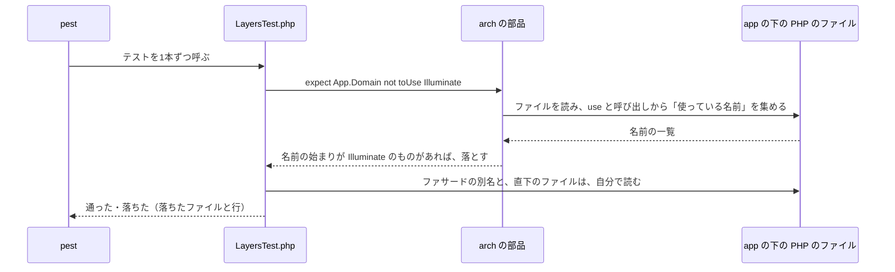

### 名前

| 名前 | 理由 | ほかの候補と、選ばなかった理由 |
| --- | --- | --- |
| `LayersTest` | 層（layer）の決まりを確かめる。8章が決めた名前 | `ArchitectureTest`：フォルダの名前（`Arch`）と重なる |
| `LEGACY_CONTROLLERS`・`LEGACY_MODELS` | 「古い」ではなく、「まだ移していない」という意味。移したら消す、が読み取れる | `IGNORED_…`：なぜ外すのかが、名前から分からない |
| `OUTSIDE_LAYERS` | 設計の図（3章）の層の外にあるフォルダ（`App\Mail`・`App\Providers`） | `LEGACY_FOLDERS`：`Providers` は古いものではなく、ずっと残る |
| `LARAVEL_HELPERS` | Laravel のヘルパー関数。Domain と Application で使わないもの | `FORBIDDEN_FUNCTIONS`：Http と Infrastructure では使ってよいので、「禁止」は言いすぎ |
| テストの名前（日本語の文） | 落ちたときに、どの決まりを破ったかが、そのまま読める | 英語の名前：決まりの文（2章の表）と、言葉がずれる |

### 依存の向き

テストが確かめている向き（2章の図）。実線は、使ってよい。点線は、テストが止めている向き。

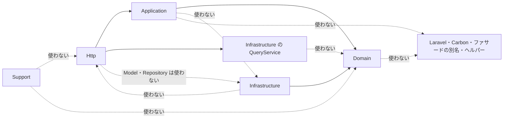

テストのファイルそのものは、アプリのどのクラスも `use` していない（名前を文字として持つだけ）。使っているのは、Pest と、Laravel の `Facade::defaultAliases()`（別名の一覧を取るため）だけ。

### レガシー版との違い

レガシー版（`legacy-repo`）には、このテストがない（`tests/Arch` は、空のフォルダだった）。層の決まりを確かめる仕組みは、何もなかった。

| | レガシー版 | この PR のあと |
| --- | --- | --- |
| 層の決まり | ない（Controller に、JWT の読み出し・DB の読み書き・判断を、全部書く） | 文書（`architecture-backend.md`）と、テスト 15本 |
| 古いコントローラー | 19個（2026-11-17〜18 に、通報・お知らせなどで増えた） | 19個のまま。一覧（`LEGACY_CONTROLLERS`）に並び、移した分だけ、一覧から消す |
| 新しいコントローラーを足す場所 | `app/Http/Controllers` の直下 | 直下には足せない（テストが落ちる）。業務のまとまりのフォルダに足す |

### 作る途中で分かったこと（8章を直した所）

| 分かったこと | どうやって分かったか | 直し方 |
| --- | --- | --- |
| `expect(関数の一覧)->not->toBeUsedIn(層の一覧)` は、違反があっても通る | Domain に `now()` を置いて流した | 層ごとに `not->toUse(関数の一覧)` |
| `arch('名前')->expect(…)` は、Larastan が指摘する | Larastan を流した（テストのフォルダも対象） | 無名関数の中に書く |
| `arch()` は、名前の始まりで比べる | ライブラリのコードを読んだ（`leaveByNameStart`） | ファサードの別名と、直下のファイルは、完全に一致で比べるテストを別に書いた |
| 最初に書いた正規表現は、`use DB as Database;`・`use Log, DB;` を見逃した | 2回目のレビューで、レビュー役が置いて確かめた | `use` の文を1つずつに分けて、名前を比べる |

どれも、「テストが通った」だけでは分からなかった。新しい層にファイルがないあいだは、当てはまるものがなく、効いていないテストも通る。**違反を置いて、落ちるのを見る**ことで分かった。

### 説明の練習

（これから。人が説明したら、ここと `docs/onboarding/quiz-log.md` に残す）

## PR #232（#105 管理画面の API テストの土台と CI）

アプリのコード（`backend/admin/app`）は変えていない。管理画面のテストを、会員の側と同じ土台（Pest・本物の PostgreSQL・違う DB なら止める・部品）にした。

### ディレクトリの設計

```text
backend/admin/
├── composer.json・composer.lock   ← Pest を足した（会員の側と同じ版）
├── phpunit.xml                    ← DB を、SQLite のメモリ DB から、PostgreSQL の matching_admin_test に
└── tests/
    ├── TestCase.php               ← 違う DB なら止める。会員の側のマイグレーションの置き場を足す
    ├── Pest.php                   ← 足した。Feature に、TestCase と RefreshDatabase を付ける
    ├── Support/                   ← 足した。テストの部品
    │   ├── functions.php          （createAdmin・createMember・actingAsAdmin・adminToken）
    │   ├── TestAdmin.php          （createAdmin の返り値）
    │   └── TestMember.php         （createMember の返り値）
    └── Feature/
        ├── HealthTest.php         ← 足した。土台が、アプリを立ち上げられること
        ├── MemberListTest.php     ← 足した。見本の API テスト（会員の一覧）
        └── Support/SupportFunctionsTest.php   ← 足した。部品のテスト
docker/db/init/02-create-admin-test-db.sql   ← 足した。matching_admin_test を作る
.github/workflows/admin-backend.yml          ← テストの仕事を足した
```

- 置き場の理由：会員の側（`backend/client/tests/`）と、同じ並びにした（`agents/rules/testing.md`）。片方を知っていれば、もう片方も読める
- **表の作り（マイグレーション）は、管理画面に置かない。** 正本は `backend/client/database/migrations` の1か所で、テストのときに、そこを指して表を作る（`03-how.md` の案 A）
- ほかに置ける場所と、置かなかった理由
  - マイグレーションを管理画面にコピーする（案 C）：管理画面だけで閉じるが、正本が2つになり、ずれる
  - 会員の側と同じ DB（`matching_test`）を使う（案 B）：準備は少ないが、2つのテストを同時に流すと、表の作り直しがぶつかる
  - 部品を、2つのアプリで共有する：管理画面は、会員の側のコードを読み込まない決まり（12 の解説）。なので、同じ名前の部品が2つある

### クラスの責務

| クラス・ファイル | 知っていること | すること | しないこと |
| --- | --- | --- | --- |
| `Tests\TestCase` | テスト用の DB の名前（`matching_admin_test`）・会員の側のマイグレーションの置き場 | 違う DB なら、表を触る前に止める。マイグレーションの読み込み先を足す | 表を作る・巻き戻す（`RefreshDatabase` の仕事） |
| `tests/Support/functions.php` | 表の列と、行の形（退会のときのメールアドレスの書き換え など）・管理者の JWT の中身 | 管理者・会員の行を入れる。ログインした状態にする | 購入・停止の履歴・いいね・マッチ・メッセージ・監査ログを作る。API を呼ぶ |
| `TestAdmin`・`TestMember` | 作った行の、テストで使う値（ID・役割・`public_id`・メールアドレス・性別） | 値を運ぶだけ（`readonly`） | DB を読む・書く |

### メソッドの表

#### `createAdmin()`

- 入力：役割（既定は `owner`）・名前（既定は「テスト管理者」）
- 戻り値：`TestAdmin`
- 副作用：`admins` に1行
- 失敗のしかた：役割が `owner`・`viewer` 以外なら `InvalidArgumentException`（行を入れる前）
- 呼ぶ所：テスト

#### `createMember()`

- 入力：性別・有料・退会・停止・ニックネーム
- 戻り値：`TestMember`
- 副作用：`users` に1行・`profiles` に1行
- 失敗のしかた：性別が `male`・`female` 以外・ニックネームが空の文字なら `InvalidArgumentException`（行を入れる前）
- 呼ぶ所：テスト

#### `actingAsAdmin()`

- 入力：`TestAdmin`
- 戻り値：テストの入口（`->getJson(…)` と続ける）
- 副作用：`Authorization` ヘッダーを付ける
- 失敗のしかた：―
- 呼ぶ所：テスト

#### `adminToken()`

- 入力：`TestAdmin`
- 戻り値：JWT の文字
- 副作用：なし
- 失敗のしかた：鍵が空・短いと、ライブラリが例外を出す（`Provided key is too short`）
- 呼ぶ所：`actingAsAdmin()`。期限切れを試すテストは、使わずに自分で作る

#### `TestCase::createApplication()`

- 入力：―
- 戻り値：アプリ
- 副作用：マイグレーションの読み込み先を足す
- 失敗のしかた
  - DB が `pgsql`・`matching_admin_test` でなければ `RuntimeException`
  - 会員の側のマイグレーションの置き場がなければ `RuntimeException`
- 呼ぶ所：テストごとに、Laravel が呼ぶ

大事な所の抜き出し（3か所）。

① 違う DB なら、表を触る前に止める。会員の側のテスト用（`matching_test`）でも止める。

```php
if ($connection !== 'pgsql' || $database !== 'matching_admin_test') {
    throw new RuntimeException("管理画面のテストは、テスト用の DB（pgsql・matching_admin_test）だけで動かす。…");
}
```

② 表は、会員の側のマイグレーションで作る。`migrate:fresh` が読む置き場に、足す。

```php
$app->afterResolving('migrator', static function (Migrator $migrator) use ($path): void {
    $migrator->path($path);   // $path は backend/client/database/migrations
});
```

③ 部品は、表に直接入れる（管理画面は Model を持たない）。決まっていない値は、入れる前に止める。

```php
if (! in_array($role, ['owner', 'viewer'], true)) {
    throw new InvalidArgumentException("createAdmin() の役割は owner か viewer。渡された値：{$role}");
}
$id = DB::table('admins')->insertGetId([/* … */]);
```

### 呼び出しの流れ

見本のテスト（会員の一覧）を1本流したとき。

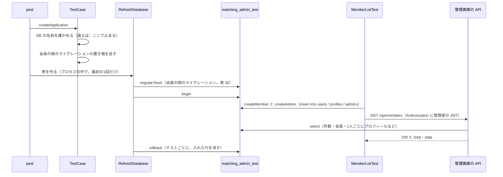

### 名前

| 名前 | 理由 | ほかの候補と、選ばなかった理由 |
| --- | --- | --- |
| `matching_admin_test` | 会員の側の `matching_test` に、だれのテストかを足した | `matching_test_admin`：`matching_test` で始まるので、名前の始まりで比べる確かめがあると、取りちがえる |
| `createAdmin()`・`createMember()`・`actingAsAdmin()` | 会員の側の部品（`createMember()`・`actingAsMember()`）と、言い方をそろえた | `makeAdmin()`：Laravel の Factory では、`make` は「DB に入れない」の意味 |
| `adminToken()` | 会員の側の `memberToken()` と対 | `jwt()`：だれのトークンかが、名前から分からない |
| `TestAdmin`・`TestMember` | テストで作ったもの、と分かる。アプリの Model ではない | `Admin`・`Member`：あとで作る Domain のクラスと、名前がぶつかる |

### 依存の向き

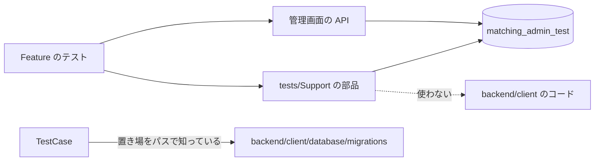

管理画面のテストが、会員の側について知っているのは、マイグレーションの置き場のパスだけ（PHP のクラスは、読み込まない）。置き場を動かすと、`TestCase` の1行を直す。

### レガシー版との違い

| | レガシー版（`legacy-repo`） | この PR のあと |
| --- | --- | --- |
| テストの DB | SQLite のメモリ DB。マイグレーションがないので、表のない DB で走る | PostgreSQL の `matching_admin_test`。表は、会員の側のマイグレーションで 30 |
| テストの道具 | PHPUnit だけ | Pest（会員の側と同じ版） |
| テスト | 0本 | 18本（土台 1・見本 3・部品 14） |
| CI | 整形と静的解析だけ | テストも流れる |

### 作る途中で分かったこと

| 分かったこと | どうやって分かったか | 直し方 |
| --- | --- | --- |
| ライブラリを入れるとき、範囲を絞らないと、Laravel 本体まで上がる | 入れたあとの差分を見た | Pest と PHPUnit だけを指定して入れ直した。一緒に上がった1つ（`symfony/polyfill-php85`）も、レビューのあとに戻した |
| `$this->getJson()` は、Larastan が指摘する | Larastan を流した | 会員の側と同じく、`Pest\Laravel\getJson` の関数で呼ぶ |
| 部品に、決まっていない役割や性別が、そのまま入る | レビュー。表に、止める制約がない | 部品の入り口で止める |
| 表に直接入れる部品は、会員の側の表が変わっても、気づけない | レビュー | 部品が行を入れる表の、列の名前の一覧を、テストに書いた |

### 説明の練習

（これから。人が説明したら、ここと `docs/onboarding/quiz-log.md` に残す）

## PR #239（#236 設計の決まりを Controller → Service → Model に）

コードは変えていない（決まりとアーキテクチャのテストだけ）。解説の本体は `agents/rules/architecture-backend.md` の4章（見本）と、`docs/backend.md` の3章（移行の地図）。

### 説明の練習

#### 1回目：ニックネームを直す API を作るとき（2026-11-19）

リーダーが「自分のプロフィールのニックネームを直す API を、新しい形で作るとき、どのファイルに何を書くか」と聞いた。

##### 問い1：通るファイルと仕事

- 人の答え
  - 最初はレガシー版の形（Controller にロジックと保存）
  - ヒントのあと、Middleware・Request・Service・Model・Resource の仕事を5つとも合わせた
- 結果：一部（ヒント1）

##### 問い2：「空にできない」の置き場

- 人の答え：Service
- 結果：ずれた（正しくは Request。値1つで決まる入力の形・422）

##### 問い3：`PATCH /me` で他人を直せない理由

- 人の答え：Middleware で判断する
- 結果：一部（URL に相手の ID がないこと、が足りない）

##### 次にやること

- #237 で実物を作ったあとに、同じ流れをヒントなしで説明する

## PR #240（#237 ホームのプロフィールの API を Service に移す）

`GET`・`PUT /api/users/{user_id}` を、レガシー版の `ProfileController`（55行）から、Controller → Service → Model の形に移した。動きは変えていない。

### ディレクトリの設計

```text
backend/client/
├── app/
│   ├── Http/
│   │   ├── Controllers/Profile/ProfileController.php   新しい Controller（直下の古いものは消した）
│   │   └── Middleware/IdentifyMember.php               トークンがあれば、ログインしている人を載せる
│   └── Services/Profile/ProfileService.php             読む・探す・書き換える
└── tests/
    ├── DummyData/                                      テストの会員・マッチ・トークンを作るクラス
    └── Feature/Profile/ShowTest.php・UpdateTest.php    今の動きを確かめる API テスト
```

#### `Profile/` のフォルダ

- 理由（`architecture-backend.md` の3章）：置き場の中を業務のまとまりで分ける。プロフィールは `Profile`（`docs/backend.md` の2章）
- ほかに置ける所と、置かなかった理由
  - `Members/`：会員の検索・通報なども入り、何のまとまりか分かりにくい（人が決めた）

#### `IdentifyMember`（Middleware）

- 理由（`architecture-backend.md` の4章）：トークンを読むのは Middleware だけ
- ほかに置ける所と、置かなかった理由
  - Controller で読む：レガシー版の形。29か所のコピーと同じ形が、もう1つ増える
  - Service で読む：Service は HTTP を知らない

#### Resource を作らない

- 理由（`architecture-backend.md` の4章）：返す項目を選ぶときに作る。今は全部の列を返すので、作っても中身がない
- ほかに置ける所と、置かなかった理由
  - `ProfileResource` を作り、`toArray()` をそのまま返す：作ったあと、中身がないので消した

### クラスの責務

- `ProfileController`
  - URL の `{user_id}` とリクエストを知っていて、Service を呼んで JSON にする
  - DB と JWT は知らない
- `ProfileService`
  - 会員とプロフィールの読み方・2人のトークルームの探し方・書き換え方を知っていて、Model を呼ぶ
  - HTTP（リクエスト・状態コード）は知らない
- `IdentifyMember`
  - JWT の読み方を知っていて、ログインしている人の `users.id` を `login_user_id` に載せる
  - トークンがなくても止めない
  - 会員が使えるか（退会・停止）は見ない

### メソッドの表

#### `ProfileService::showProfile`

- 入力：`$targetPublicId`（UUID）・`$viewerId`（`users.id` か null）
- 戻り値：`array{target: User, roomId: string|null}`
- 副作用：なし（読むだけ）
- 失敗のしかた
  - いない会員：`firstOrFail()` の例外 → 404（文に Model の名前が出る）
  - UUID の形でない：PostgreSQL のエラー → 500
- 呼ぶ所：`ProfileController::show`

#### `ProfileService::updateProfile`

- 入力：`$targetPublicId`・`$input`（送られた項目の全部）
- 戻り値：書き換えた `Profile`
- 副作用：`profiles` の1行を書き換える
- 失敗のしかた：いない会員・プロフィールがない：`RuntimeException` → 500
- 呼ぶ所：`ProfileController::update`

#### `ProfileController::show`

- 入力：`Request`・`$targetPublicId`
- 戻り値：JSON（`users` の列・`profile`・`room_id`）
- 副作用：なし
- 失敗のしかた：Service の例外がそのまま上がる
- 呼ぶ所：ルート `GET /api/users/{user_id}`

#### `ProfileController::update`

- 入力：`Request`・`$targetPublicId`
- 戻り値：JSON（`profiles` の列）
- 副作用：Service と同じ
- 失敗のしかた：同上（Service の例外がそのまま上がる）
- 呼ぶ所：ルート `PUT /api/users/{user_id}`

#### `IdentifyMember::handle`

- 入力：`Request`・次の処理
- 戻り値：次の処理の応答
- 副作用：`login_user_id` を載せる
- 失敗のしかた：壊れた・期限の切れたトークン：JWT の例外 → 500
- 呼ぶ所：ルートの `->middleware('member.identify')`

見る人がいるときだけ、トークルームを探す（`ProfileService.php`）：

```php
$target = User::query()->where('public_id', $targetPublicId)->firstOrFail();
$target->load('profile');

return [
    'target' => $target,
    'roomId' => $viewerId === null ? null : $this->findSharedRoomId($viewerId, $target->id),
];
```

外の番号（UUID）を、中の番号（`users.id`）に置き換えてから、プロフィールを探す（`ProfileService.php`）：

```php
$targetId = User::query()->where('public_id', $targetPublicId)->value('id');
$profile = Profile::query()->where('user_id', $targetId)->first()
    ?? throw new RuntimeException('プロフィールが見つからない');
$profile->update($input);
```

HTTP の側の名前（`$loginUserId`）から、業務の側の名前（`$viewerId`）に渡す（`ProfileController.php`）：

```php
$loginUserId = $request->attributes->get('login_user_id');   // IdentifyMember が載せる。トークンがなければ null
$result = $this->profiles->showProfile($targetPublicId, is_int($loginUserId) ? $loginUserId : null);
```

### 呼び出しの流れ

ログインしている人が、相手のプロフィールを見るとき（SQL 5本）。

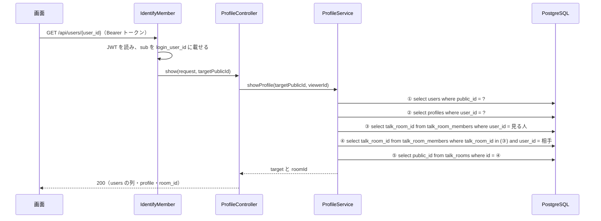

トークンがないときは、`IdentifyMember` が何も載せず、①②の2本だけになる。書き換えは、`users` の `id` → `profiles` を1件 → `update profiles` の3本。

### 名前

#### URL の `{user_id}`

- ほかの候補：`{publicId}`（前の名前）
- 選ばなかった理由：用語集の「ID の名前」の決まり（2026-11-16）と違う

#### `$targetPublicId`・`$targetId`

- ほかの候補：`$publicId`・`$memberId`
- 選ばなかった理由：「だれの」「どちらの番号か」が分からず、読み違えた（用語集の「コードの中の、会員の番号の名前」）

#### `login_user_id`・`$loginUserId`

- ほかの候補：`member_id`・`viewer_id`
- 選ばなかった理由
  - `member_id` は、用語集では管理画面の UUID
  - `viewer_id` は、書き換えの API で使うと意味が合わない

#### `$viewerId`（Service）

- ほかの候補：`$loginUserId`
- 選ばなかった理由：Service は HTTP を知らない。コマンドから呼ぶときも「見る人」なら通じる

#### `showProfile`・`updateProfile`

- ほかの候補：`showFor`・`update`・`updateMyProfile`・`updateTargetProfile`
- 選ばなかった理由
  - 名前には「何ができるか」を書き、「だれが呼べるか」（ログインしているか・本人か）は入れない
  - 「だれが呼べるか」は、Middleware とメソッドの中の条件で決める（`architecture-backend.md` の3章。人が決めた）
  - `update` は、Controller と同じ名前になる（3章）

#### `IdentifyMember`

- ほかの候補：`AuthenticateMember`
- 選ばなかった理由
  - 認証（通さない）はしない。だれかを見分けるだけ
  - `AuthenticateMember` は、401 を返す Middleware の名前に取っておく

### 依存の向き

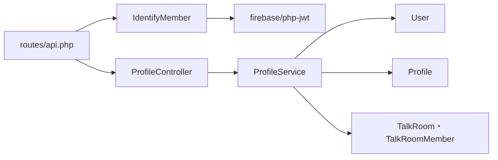

逆向き（Model → Service、Service → Http）はない。`tests/Arch/LayersTest.php` が確かめる。`IdentifyMember` は、決まりの「Middleware → Service」をまだ使っていない（使えるかを見ないため）。

### レガシー版との違い

| | レガシー版（`legacy-repo`） | この PR のあと |
| --- | --- | --- |
| 置き場 | `ProfileController` の1ファイル（55行）に、JWT・SQL 5本・書き換えが全部 | Middleware（JWT）・Controller（受け取る・返す）・Service（SQL と書き換え）の3つ |
| トークンを読む所 | `show` の中（`if ($token)`） | `IdentifyMember`（`$token !== null && $token !== ''`） |
| テスト | 0本 | 14本（見る 8・書き換え 6） |
| 応答・状態コード・SQL の本数 | ― | 同じ（テストを変えずに通る。SQL は 2・5・3本で同じ） |

移して、細かく動きが変わる所が2つある（どちらも、テストでは確かめていない。`pr-review` で見てもらう）。

- トークンが `0` という文字のとき：レガシー版は `if ($token)` で「ない」と見て 200。今は読もうとして、JWT の例外で 500
- 正しく署名したトークンの `sub` が数字でないとき：レガシー版は、そのまま SQL に入れて 500。今は「ログインしていない」と見て 200（`room_id` は null）。この API が作るトークンの `sub` は、いつも数字

### 直した課題と、現場での意味

課題と、決めたことは `05-problems.md` の「#237」の節。

- だれが困らなくなるか：次にプロフィールの不具合（見せすぎ・他人の書き換え）を直す人。どこに何があるかが分かれ、テストが14本あるので、直したら落ちる・通るで確かめられる
- どう気づけるようになるか：分かっている不具合が、テストとコードのコメントに書いてある。直すときは、そのテストを要件どおりに戻せば落ちる
- 数字：テスト 0 → 14本。SQL の本数は前と後で同じ（2・5・3本）

### 次の改善の候補

どれも、このチケットでは直さない（動きを変えずに移すチケットのため）。直すときは、テストの「分かっている不具合」を要件どおりに戻し、落ちる（Red）のを見てから直す。

#### トークルームを探す SQL を1本にする

- 今どうなっているか：`ProfileService::findSharedRoomId` が、自分のルームの一覧 → 相手もいるルーム → ルームの番号、の3本を流す
- 直すとどうなるか
  - `talk_room_members` を2回つなぐ（JOIN）1本で探せる
  - ログインして見ると、5本が3本になる
- 気づいた所：前と後の SQL の本数を測ったとき

#### 2人のルームを探す条件を、Model のスコープにする

- 今どうなっているか
  - `whereIn('talk_room_id', …)->where('user_id', …)` を Service に直接書いている
  - `architecture-backend.md` の4章（条件が2つ以上なら Model のスコープ）から外れている
  - トークルームの機能を直すときに移す（PR #240 のレビューで、人が決めた）
- 直すとどうなるか：トークの API でも同じ条件を使うので、`TalkRoomMember` の1か所にまとめられる
- 気づいた所：Service に移したとき

#### 返す項目を選ぶ（FR-002）

- 今どうなっているか：`toArray()` で、メールアドレスなども全部返す
- 直すとどうなるか：Resource を作り、返してよい項目だけにする（`architecture-backend.md` の Resource の決まり）
- 気づいた所：今の動きを確かめるテスト

#### 入力を確かめる（FR-010・FR-006）

- 今どうなっているか：`$request->all()` を、そのまま `fill()` に渡す
- 直すとどうなるか：Form Request の `validated()` だけを渡す。空のニックネームは 422
- 気づいた所：今の動きを確かめるテスト

#### 他人のプロフィールを書き換えられないようにする（FR-AUTH-022）

- 今どうなっているか：PUT のルートに、ログインを求める Middleware がない
- 直すとどうなるか：ログインを求め、URL の会員が自分でなければ 403
- 気づいた所：今の動きを確かめるテスト・Bruno

#### 壊れたトークンを 401 にする

- 今どうなっているか：`IdentifyMember` が、JWT の例外のまま 500 を返す
- 直すとどうなるか
  - 例外を受けて 401 を返す
  - トークンを読むコード（17のコントローラーに29か所）も、Middleware にまとめる
- 気づいた所：Middleware を作ったとき

#### 見つからないときの応答をそろえる

- 今どうなっているか：GET は Laravel の 404（文に Model の名前が出る）、PUT は 500
- 直すとどうなるか：どちらも、決まった形の 404 にする（`architecture-backend.md` の7章）
- 気づいた所：今の動きを確かめるテスト

### 説明の練習

#### 1回目：メッセージを送るボタンが出ない（2026-11-19）

リーダーが、問い合わせの場面で聞いた：「マッチしている相手のプロフィールを開いたのに、『メッセージを送る』のボタンが出ない」（画面は、`room_id` が null だとボタンを出さない）。

##### 問い1：通るコードの順

- 人の答え：ルート → `IdentifyMember` → `ProfileController` → `ProfileService`
- 結果：合っている

##### 問い2：見る人の番号の渡り方

- 人の答え：トークンの `sub` → Controller は `$loginUserId` → Service は `$viewerId`（ヒント1）
- 結果：合っている。あいだは `$request->attributes` の `login_user_id`

##### 問い3：`room_id` が null になる所

- 人の答え：トークンがないとき・トークルームの行がないとき（ヒント1）
- 結果：合っている
  - ほかに、`sub` が数字でないとき・`talk_room_members` に片方の行しかないとき

##### 問い4：それを確かめているテスト

- 人の答え：「マッチしていない相手なら、room_id は null」と「マッチしている相手なら、room_id に…入る」
- 結果：一部
  - 「トークンがない」の場面は、どのテストも `room_id` を確かめていない（「200 で見られる」は状態コードだけ）

##### 分かったこと・次にやること

- 分かったこと：チケットの「今の動きを確かめるテスト」の一覧にあった「トークンなしなら `room_id` は null」が、テストに入っていなかった
- 次にやること：テストの名前だけでなく、確かめている行（`assert…`）まで見る

#### 2回目：しばらく開かなかったらエラーが出た（2026-11-19）

レビューのあと、承認の前に、もう1問聞いた：「しばらくアプリを開いていなかったら、相手のプロフィールでエラーが出た」（トークンの期限が切れていた）。

##### 問い1：API が返すものと原因

- 人の答え：エラーの応答を返さない。`if ($token !== null && $token !== '')` で例外を扱っていない
- 結果：一部
  - 返すのは 500。例外を投げるのは、その中の `JWT::decode`（`ExpiredException`）

##### 問い2：確かめているテスト

- 人の答え：「トークンがおかしい」の、壊れたトークンのテスト
- 結果：一部。期限切れは「期限の切れたトークンなら 500」

##### 問い3：401 に直す順

- 人の答え
  - 最初は「500 のままが望ましい」
  - ヒントのあと、テストを 401 に変える → 流す → 直す → 流す
- 結果：一部（ヒント1）
  - 500 は分かっている不具合で、要件（FR-AUTH-013）は 401
  - 通ったら、テストの名前を直し、コメントを消す

##### 問い4：なぜ先に Red を見るか

- 人の答え：先に直すと、テストが本当に確かめているか分からない
- 結果：合っている（M1 がその例）

##### 次にやること

- 「分かっている不具合」のコメントは、前半が要件（あるべき動き）、後半が今そうなる理由、と読む

## PR #242（#241 エラーハンドリングと例外処理の土台）

業務の例外（決まりどおりに断ったこと）を、`bootstrap/app.php` の1か所で状態コードと文に変える土台を作った。最初の例外は「会員が見つからない」の1つ。あわせて、会員の側のコードの名前を `User` にそろえた。

### ディレクトリの設計

```text
backend/client/
├── app/Exceptions/
│   ├── BusinessException.php              業務の例外の親（abstract）
│   └── UserNotFoundException.php          会員がいない（いくつものまとまりで使うので直下）
├── bootstrap/app.php                      例外を状態コードと文に変える所（withExceptions）
├── config/app.php                         言語を ja に決めた
└── lang/ja/errors.php                     画面に出るエラーの文
```

#### `UserNotFoundException` は `app/Exceptions/` の直下

- 理由（決まり）
  - いくつもの業務のまとまり（プロフィール・いいね・トーク）で使う例外は、直下に置く
  - `architecture-backend.md` の7章。PR #242 のレビューで決めた
- ほかに置ける所と、置かなかった理由
  - `app/Exceptions/Users/`：`Users` は業務のまとまりの一覧にない
  - `Exceptions/Profile/`：いいねやトークを移す人が、自分のまとまりに同じ例外をもう1つ作るおそれがある

#### 状態コードは `bootstrap/app.php`

- 理由（決まり）：`architecture-backend.md` の7章（1か所で見る）
- ほかに置ける所と、置かなかった理由
  - 例外のクラスの `render()`：状態コードが例外のファイルごとに散らばる

#### 文は `lang/ja/errors.php`

- 理由（決まり）：Laravel の標準。入力の確かめ（422）の文も同じ仕組みで日本語にできる
- ほかに置ける所と、置かなかった理由
  - 例外のクラスの中：一覧で見られない
  - 定数のクラス：422 の文と置き場が2種類になる

### クラスの責務

- `BusinessException`
  - 「決まりどおりに断った」ことを表す親。中身はない
  - 状態コードも文も知らない
- `UserNotFoundException`
  - 「会員がいない」ことだけを表す
  - 文と状態コードは知らない
- `bootstrap/app.php` の `withExceptions`
  - どの例外を、どの状態コードと文に変えるか、どれをログに出さないかを知っている
  - 業務のことは知らない
- `lang/ja/errors.php`
  - 画面に出る文だけを知っている

### メソッドの表

| 場所 | 入力 | 出力 | 副作用 | 失敗のしかた | 呼ぶ所 |
| --- | --- | --- | --- | --- | --- |
| `ProfileService::showProfile` | `$targetPublicId`・`$viewerId` | `array{target: User, roomId: string\|null}` | なし | いない会員：`UserNotFoundException` | `ProfileController::show` |
| `ProfileService::updateProfile` | `$targetPublicId`・`$input` | `Profile` | `profiles` の1行を書き換える | いない会員：`UserNotFoundException`。プロフィールがない：`RuntimeException`（500。分かっている不具合） | `ProfileController::update` |
| `render(fn (UserNotFoundException $e) => …)` | 投げられた例外 | 404・`{"message": "会員が見つかりません"}` | なし | ― | Laravel（例外が Controller の外まで来たとき） |
| `dontReport([BusinessException::class])` | ― | ― | 業務の例外を、エラーのログに書かない | ― | Laravel（例外を記録するとき） |

Service は、見つからなければ例外を投げるだけ（`ProfileService.php`）：

```php
$target = User::query()->where('public_id', $targetPublicId)->first()
    ?? throw new UserNotFoundException;
```

例外を応答に変えるのは、ここだけ（`bootstrap/app.php`）：

```php
// 業務の例外を、状態コードと文に変えるのはここだけ（architecture-backend.md の7章）。例外を足したら、ここに1行足す。文は lang/ja/errors.php
$exceptions->render(fn (UserNotFoundException $e) => response()->json(['message' => __('errors.user_not_found')], 404));

// 業務の例外は、決まりどおりに断っただけなので、エラーのログに出さない。親の1つだけを書く
$exceptions->dontReport([BusinessException::class]);
```

文は、言葉のファイルにだけ書く（`lang/ja/errors.php`）：

```php
return [
    'user_not_found' => '会員が見つかりません',
];
```

### 呼び出しの流れ

いない会員を見るとき。

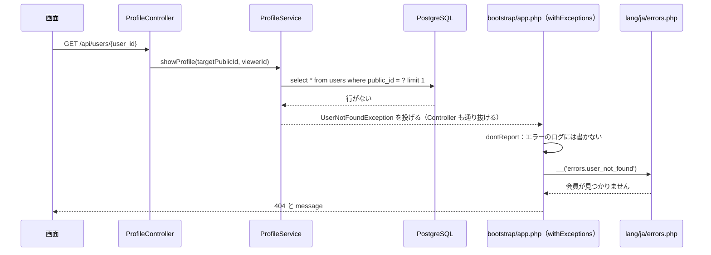

### 名前

| 名前 | ほかの候補 | 選ばなかった理由 |
| --- | --- | --- |
| `UserNotFoundException` | `MemberNotFoundException` | 表・Model・URL が `users` なのに `Member` と呼ぶと、同じものか分からなくなる（用語集の「名前の付け方」） |
| `BusinessException` | `DomainException`（PHP の標準にある） | PHP の `DomainException` は「値が決まった範囲の外」という別の意味で使われる |
| `errors.user_not_found` | `messages.404` | 状態コードではなく、何が起きたかで名前を付ける（同じ 404 でも、文は違う） |

### 依存の向き

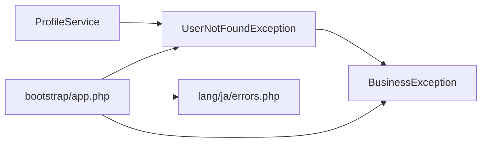

Service は `bootstrap/app.php` を知らない。例外のクラスは、HTTP も文も知らない。逆向きはない（`tests/Arch/LayersTest.php` が、業務の例外が Http を使わないことを確かめる）。このテストは、`app/Exceptions` にファイルがないあいだは、何も確かめずに通っていた。この PR で初めてファイルを置いたので、`UserNotFoundException` にわざと `Illuminate\Http\JsonResponse` を入れて、落ちるのを見てから戻した。

### レガシー版との違い

| | レガシー版 | この PR のあと |
| --- | --- | --- |
| 見つからないとき | `firstOrFail()` を Laravel に任せる（404 で、文に Model の名前）。書き換えは null に `fill()` して 500 | Service が `UserNotFoundException` を投げ、`bootstrap/app.php` が 404「会員が見つかりません」に変える |
| エラーの文の置き場 | Controller ごとに手で書く（401 が30か所・403 が9か所・404 が7か所） | `lang/ja/errors.php`（今は1つ。ほかは、その API を移すときに移す） |
| 言語 | 環境変数（既定は `en`） | `config/app.php` で `ja` に決めた |

### 直した課題と、現場での意味

課題と、決めたことは `05-problems.md` の「#241」の節。

- だれが困らなくなるか：古い URL を開いた会員（Model の名前ではなく「会員が見つかりません」が出る）と、運営（書き換えの 500 が 404 になり、エラーのログに、本当の不具合だけが残る）
- どう気づけるようになるか：業務の例外はログに出ないので、エラーのログに出るものは、思っていなかった失敗だけになる
- 数字：いない会員の PUT が 500 → 404。エラーの文の置き場が、手書きの46か所 → これから移す先の1か所

### 次の改善の候補

#### 「`public_id` で会員を探し、いなければ `UserNotFoundException`」を1か所にする

- 今どうなっているか：`ProfileService` の `showProfile` と `updateProfile` の2か所に書いている
- 直すとどうなるか
  - #128 などで、ほかの Service にも増える
  - 3つ目ができるときに、User のスコープか1つのメソッドにまとめる（退会した会員の扱いを変えるときに、直し漏れが起きない）
- 気づいた所：PR #242 のレビュー（A3）

#### `ProfileFactory` の `realText()` を軽い書き方にする

- 今どうなっているか
  - 日本語の長い文を毎回読むので、テストが増えると 128MB を超える
  - 今は `phpunit.xml` で、テストのときだけ 512MB にした
- 直すとどうなるか
  - 上限を上げずに流せる
  - 試しのデータ（シーダー）の作り方も変わるので、別に決める
- 気づいた所：PR #242 の直し（テストが48本でメモリが足りなくなった）

#### 会員の側の見本の `memberId`・`findMember` を、`User` の名前にそろえる

- 今どうなっているか：`architecture-backend.md` の 99・118・185〜196・410・415行目
- 直すとどうなるか
  - 見本をコピーしても、member と user が混ざらない
  - 書き換えの操作の引数の名前を決めるときに、一緒に直す
- 気づいた所：PR #242 のレビュー（S5）

### 説明の練習

#### 1回目：エラーのログに毎日出ている（2026-11-19）

リーダーが、運営からの相談の場面で聞いた：「エラーのログに、毎日 `UserNotFoundException` が何百件も出ている」。

##### 問い1：なぜ出ないはずか

- 人の答え：`render` の行（404 と文を返す）があるから
- 結果：ずれていた
  - ログに出さないのは `dontReport` の行
  - Laravel は、記録する（report）と応答を作る（render）を別々に行う

##### 問い2：それでも出るとしたら

- 人の答え：`UserNotFoundException` で起きている
- 結果：足りない。考えられるのは次の3つ
  - `dontReport` の行を消した
  - `BusinessException` を継がない形にした
  - どこかで受け止めて、自分でログに書いた

##### 問い3：確かめているテスト

- 人の答え：「いない会員を見ても、エラーのログには出さない」
- 結果：合っている

##### 問い4：`catch` して `Log::error()` を呼ぶと、ログに出るか

- 人の答え：出ない
- 結果：ずれていた。出る
  - `dontReport` が止めるのは Laravel の記録のしくみだけで、`Log::error()` は通らない
  - 止めるのは、7章の「try-catch を書かない場面」（受け止めて、記録して、投げ直すだけの `catch` は書かない）

##### 次にやること

- 例外の扱いは「記録する（report）」と「応答を作る（render）」の2つに分けて読む。`dontReport` は前者、`render` は後者

#### 2回目：`render` の1行を書き忘れた PR（2026-11-19）

レビューの直しのあと、承認の前に、もう1問聞いた：「#128 で `ProfileForbiddenException` を足した人が、`render` の1行を書き忘れて PR を出した」。

##### 問い1：CI でどのテストが落ち、何と出るか

- 人の答え：`BusinessExceptionsTest` が落ちる。not found のようなエラーが出る
- 結果：一部
  - 出るのは、テストに書いた文「`App\Exceptions\ProfileForbiddenException` の render を bootstrap/app.php に書いていない」

##### 問い2：テストがなかったら、本番で何が起きるか

- 人の答え：500 が出ないので、ログに出ない
- 結果：ずれていた
  - 500 は出る。出ないのはログ
  - 会員の問い合わせで、初めて気づく

##### 問い3：なぜ、その 500 はログに残らないか

- 人の答え：`dontReport([BusinessException::class])` の行があるから
- 結果：合っている

##### 次にやること

- 「応答（何が返るか）」と「記録（ログに残るか）」を、別々に答える


## PR #255（#244 の5 確認用の文字を応答に出さない。元の #133）

`User` の `#[Hidden]` に `verification_token` を足し、登録・自分の情報・相手のプロフィールの3つの応答から、確認用の文字を消した。あわせて、「自分」をコードでは `Account` と呼ぶ決まりを足した（URL の `/me` は変えない）。

### ディレクトリの設計

```text
backend/client/
├── app/Models/User.php                         #[Hidden] に1語足した
├── routes/api.php                              GET /me に、ルートの名前 legacy.profile.account.show を付けた
└── tests/
    ├── DummyData/DummyUser.php                 unverified: true を足した
    ├── Endpoints.php                           register()・account() を足した
    └── Feature/
        ├── Auth/RegisterTest.php               登録と、確認のリンク（新しい）
        ├── Members/SearchTest.php              会員の検索（新しい）
        └── Profile/
            ├── ShowAccountTest.php             自分のアカウントを見る（新しい）
            └── ShowTest.php                    相手のプロフィールを見る（1本を要件どおりに変えた）
```

#### 隠す列は `User` の `#[Hidden]`

- 理由（決まり）：同じ Model を返す3つの API が、1か所の変更で直る
- ほかに置ける所と、置かなかった理由
  - Controller ごとに `makeHidden()`：3か所に書き、4つ目の API で書き忘れる
  - Resource で返す項目を書く：応答の形が変わるので、土台4のチケットでやる（`05-problems.md`）

#### 登録のテストは `Feature/Auth/`

- 理由（決まり）：新規登録は `Auth` のまとまり（`docs/backend.md` の2章）
- ほかに置ける所と、置かなかった理由
  - `Feature/Profile/`：登録はプロフィールの操作ではない

#### 自分の情報のテストは `Feature/Profile/ShowAccountTest.php`

- 理由（決まり）
  - 「自分（見る・直す・退会）」は `Profile` のまとまり（`docs/backend.md` の2章）
  - 同じフォルダに相手の `ShowTest.php` があるので、名詞を入れて分けた
- ほかに置ける所と、置かなかった理由
  - `Feature/Account/ShowTest.php`：`Account` という業務のまとまりはない
  - `Feature/Profile/MeTest.php`：`Me` では何を指すかが分かりにくい（人が決めた）

### クラスの責務

- `User` の `#[Hidden]`
  - JSON にするときに出さない列を知っている
  - DB から読むこと・`$user->verification_token` で読むことは止めない
- `Endpoints::register()`・`account()`
  - テストで呼ぶ URL の文字を知っている
  - `/me` を、コードでは `account` と呼べるようにする
- `DummyUser::create(unverified: true)`
  - 登録した直後と同じ会員（確認していない・確認用の文字を持つ）を作る
  - Factory の既定は確認済みで、確認用の文字が空なので、隠せたかを確かめられなかった

### メソッドの表

アプリの public のメソッドは増えていない。変わったのは、Model を JSON にするときの動きだけ。

#### `response()->json($user)`（Laravel）

- 入力：`User`
- 出力：JSON。`#[Hidden]` の列（`password`・`remember_token`・`verification_token`）は入らない
- 副作用：なし
- 失敗のしかた：―
- 呼ぶ所：`UserController::store`・`UserController::index`（検索）・`AuthController::me`・`ProfileController::show`（`toArray()`）

#### テストの部品

| 場所 | 入力 | 出力 | 副作用 | 呼ぶ所 |
| --- | --- | --- | --- | --- |
| `Endpoints::register()` | ― | `'/api/users'` | なし | `RegisterTest` |
| `Endpoints::account()` | ― | `'/api/me'` | なし | `ShowAccountTest` |
| `Endpoints::searchUsers()` | ― | `'/api/users'` | なし | `SearchTest` |
| `emailVerification($token)` | 確認用の文字 | `'/api/email-verifications/{token}'` | なし | `RegisterTest` |
| `DummyUser::create(unverified: true)` | ほかの引数と同じ | `TestUser` | `users` に1行（下） | `ShowAccountTest`・`ShowTest` |

- 失敗のしかたは、どれも「―」
- `DummyUser::create(unverified: true)` が作る行：`email_verified_at` が空で、`verification_token` に40文字を入れた行

直したのは、この1行（`app/Models/User.php`）：

```php
// 確認用の文字は、確認のメールにだけ入れる。応答に出すと、メールを見ずに確認を通せる（不変条件 2）
#[Hidden(['password', 'remember_token', 'verification_token'])]
class User extends Authenticatable
```

`#[Hidden]` は JSON にするときだけ効くので、次の2つは変わらない：

```php
$user = User::where('verification_token', $token)->first();                  // 確認の API（EmailVerificationController）
'url' => config('app.frontend_url').'/verify/'.$this->user->verification_token, // 確認のメール（VerifyMail）
```

メールに入ることは、テストで確かめている（`RegisterTest.php`）：

```php
$token = DB::table('users')->where('email', 'new@example.test')->value('verification_token');
expect($token)->toBeString();
expect($token)->not->toBeEmpty();
assert(is_string($token));   // Larastan に文字だと伝える
Mail::assertSent(VerifyMail::class, function (VerifyMail $mail) use ($token): bool {
    $mail->assertSeeInText('/verify/'.$token);

    return $mail->hasTo('new@example.test');
});
```

### 呼び出しの流れ

登録のとき。

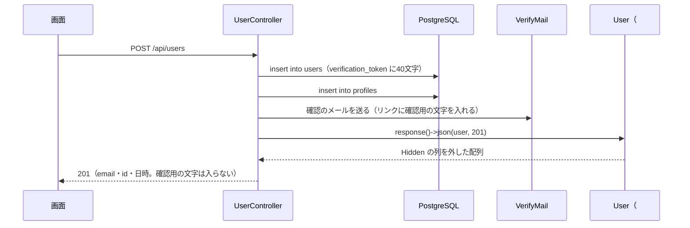

### 名前

#### コードの `Account`（URL は `/me`）

- ほかの候補：`Me`・`LoginUser`
- 選ばなかった理由
  - `Me` は、何を指すかが分かりにくい
  - `LoginUser` は、「ログインする処理」と読まれやすい
  - `Account` は、設定の画面の「アカウント」とそろう（人が決めた。用語集の「アカウント」）

#### `ShowAccountTest.php`

- ほかの候補：`MeTest.php`・`Account/ShowTest.php`
- 選ばなかった理由：上の理由と、`Account` というまとまりはないため

#### `DummyUser::create(unverified: true)`

- ほかの候補：`verified: false`
- 選ばなかった理由：ほかの引数（`paid`・`withdrawn`・`suspended`）は、既定と違う状態を `true` で表すので、そろえた

#### ルートの名前 `legacy.profile.account.show`

- ほかの候補：付けない・`profile.account.show`
- 選んだ理由と、選ばなかった理由
  - URL を変えずに、`route:list` で「自分のアカウントを見る API」と読めるようにした（人が、URL を変えずに名前を付けられるならと言ったため）
  - 今の URL なので、`legacy.` で始める（`03-how.md:206`。レビューの S2）
  - `profile.account.show` は、新しい URL の `GET /me` に付ける名前として空けておく

### 依存の向き

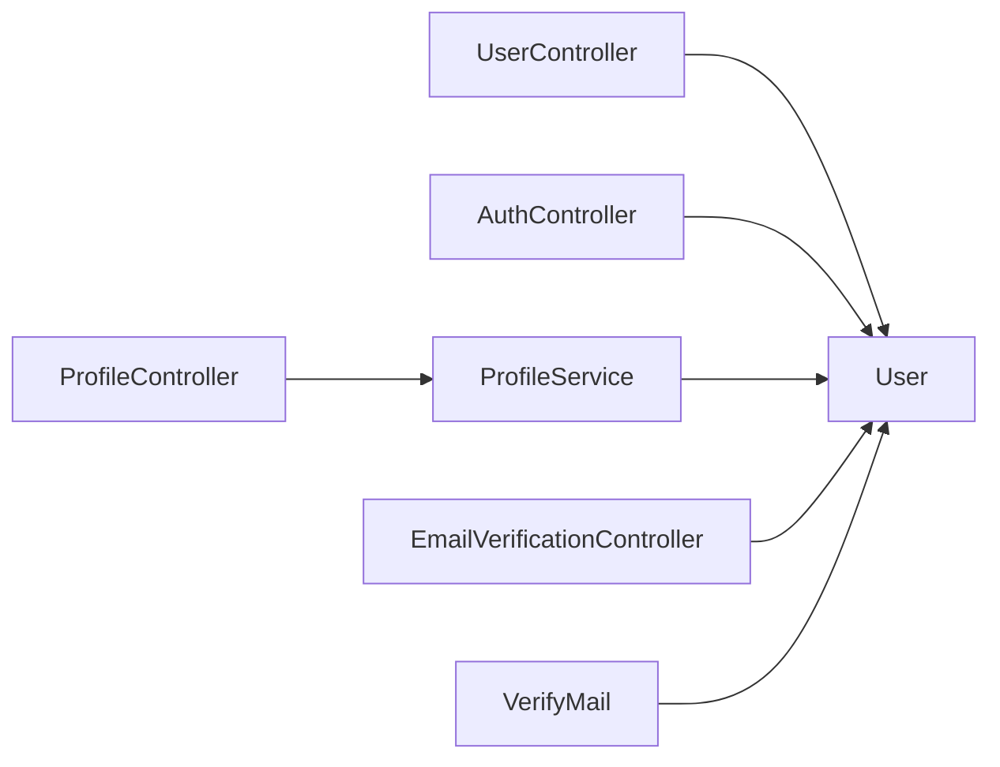

`#[Hidden]` を変えると、`User` を JSON にする所がみな変わる。今は4つ（`UserController` の登録と検索・`AuthController`・`ProfileController`）。検索は、レビューで見つけた（S1）。`EmailVerificationController` と `VerifyMail` は、JSON にしないので変わらない。

### レガシー版との違い

| | レガシー版 | この PR のあと |
| --- | --- | --- |
| 隠す列 | `password`・`remember_token`（Laravel の見本のまま） | `verification_token` を足した |
| 確認用の文字が出る API | 登録・自分の情報・相手のプロフィール（ログインしていない人にも）・検索 | なし |
| API テスト | 相手のプロフィールだけ（確認用の文字が出ることを、分かっている不具合として確かめていた） | 登録・確認のリンク・自分の情報・検索にも足した |

### 直した課題と、現場での意味

課題と、決めたことは `05-problems.md` の「#244 の5」の節。

- だれが困らなくなるか：メールアドレスを勝手に使われた人（登録の応答の文字で、メールを見ずに「確認済み」にされなくなる）と、運営（確認済みの数を、本人がメールを受け取った数として使える）
- どう気づけるようになるか：4つの API のテストが、確認用の文字が応答に出たら落ちる。新しく秘密の列を足して `#[Hidden]` に書き忘れたときは、まだ気づけない（下の「次の改善の候補」）
- 数字：確認用の文字が出る API が 4 → 0

### 次の改善の候補

#### 返す項目を API ごとに書く（Resource）

- 今どうなっているか
  - `#[Hidden]` に書いた列以外は、全部出る
  - メールアドレス・停止の理由（`suspended_reason`）・強制退会の理由も、自分の情報と相手のプロフィールに出る
- 直すとどうなるか：書いていない列は出ない。新しい列を足しても安全
- 気づいた所：課題の理解（案B）。#244 の土台4

#### 確認用の文字とパスワードの再設定の文字を、SQL のログに残さない

- 今どうなっているか：URL のパスに入るので、`QueryLogger.php:56` の `path` にそのまま残る（開発の PC だけ）
- 直すとどうなるか：ログの `path` を、ルートの形（`api/email-verifications/{token}`）にする（`logging.md`）
- 気づいた所：PR #255 のレビュー（範囲の外）

#### 「自分」の名前を `Account` にそろえる

- 今どうなっているか：次の名前が残っている
  - `AuthController::me()`・PHP の `$me`・`$myProfile`
  - ルートの引数の `{publicId}`
  - 管理画面の `Admins/MeController`
  - 画面の `Me` の型
- 直すとどうなるか：同じものに2つの呼び方がなくなる
- 気づいた所：この PR（人が「該当するところだけ」と決めた）

### 説明の練習

#### 1回目：検索を `DB::table` に書き換えた PR（2026-11-20）

リーダーが、半年後に来る PR の場面で聞いた：「検索が遅いので、`UserController::index` を `DB::table('users')->join('profiles', ...)` の形に書き換えた」。

##### 問い1：検索の応答の確認用の文字はどうなるか

- 人の答え：出なくなる。`User.php` の `#[Hidden]` に入れたから
- 結果：ずれていた。また出る
  - `#[Hidden]` は Model を JSON にするときだけ効き、`DB::table` は Model を通らない（ただの行が返る）
  - `select *` なら、確認用の文字もパスワードも出る
  - 管理画面の会員の一覧（#244 の4）が直らないのと、同じ理由

##### 問い2：CI のどのテストで気づけるか

- 人の答え：気づけない
- 結果：ずれていた
  - この PR で足した `tests/Feature/Members/SearchTest.php` が落ちる
  - `assertJsonMissingPath('0.verification_token')` は、値が `null` でもキーがあれば落ちる
  - 足す前なら、「気づけない」が正しかった

##### 問い3：`DB::table` のまま、出さないようにするには

- 人の答え：Model を直す
- 結果：ずれていた
  - Model を直しても、`DB::table` には効かない
  - `select('users.public_id', 'profiles.nickname', ...)` のように、返す列を書き出す
  - 隠す列を書く形（`#[Hidden]`）から、出す列を書く形（Resource と同じ考え方）に変える

##### 次にやること

- 守りの仕組みを説明するときは、「どの道を通ったときに効くか」まで言う（`#[Hidden]` は Model を JSON にするとき・`dontReport` は Laravel が記録するとき）
- #244 の土台4（Resource）のチケットで、もう一度確かめる

## PR #262（#243 ログインを確かめる Middleware。JWT のまま）

トークンを読み、会員のアカウントが今も使える状態か（退会・停止・強制退会）を毎回確かめる Middleware を作り、プロフィールの2本の API に付けた。#246（認証をセッションに移す）の最初の子。あわせて、メソッド・クラス・テストの名前の決まりを足した。

### ディレクトリの設計

```text
backend/client/app/
├── Http/
│   ├── Middleware/AuthenticateUser.php      ログインを確かめる（新しい）。IdentifyUser は消した
│   └── Controllers/Controller.php           loginUserId() を足した（基底のクラス）
├── Services/Auth/AuthService.php            アカウントが使える状態かを答える（新しい）
└── Models/User.php                          isAccountUsable() を足した
frontend/client/src/
└── shared/session/goToLoginAfterUnauthorized.ts   401 のあと、ログインの画面へ（新しい）
```

#### トークンを読むのは `AuthenticateUser`

- 理由（決まり）：トークンを読むのは Middleware だけ（`architecture-backend.md` の4章）
- ほかに置ける所と、置かなかった理由
  - Controller ごとに読む：今の29か所のコピーと同じになる

#### 「使える状態か」の判定は `User::isAccountUsable()`

- 理由（決まり）
  - 行の値だけで決まる事実は、Model の1か所に置く
  - ログインの API も、同じ判定が要る
- ほかに置ける所と、置かなかった理由
  - Middleware：Model を使えない（層のテストで止まる）。ログインと2か所になる

#### `AuthService::isUserAccountUsable()`

- 理由（決まり）：Middleware は Model を使わないので、番号から会員を探して Model に聞く窓口が要る（2章）
- ほかに置ける所と、置かなかった理由：―

#### 401 の応答は `bootstrap/app.php`

- 理由（決まり）：例外を応答に変えるのは1か所（7章。#241 の 404 と同じ形）
- ほかに置ける所と、置かなかった理由
  - Middleware で `response()->json()`：401 の作り方が2か所になる

#### `loginUserId()` は基底の `Controller`

- 理由（決まり）
  - 会員の番号を読む所を1つにする
  - 付け忘れたとき、「会員 0 番」として動かない
- ほかに置ける所と、置かなかった理由
  - 各 Controller で `$request->attributes->get()`：#257 で15か所にコピーが増える

#### 画面の `goToLoginAfterUnauthorized` は `shared/session/`

- 理由（決まり）：ログインした自分を消すのは `shared/session`（`architecture-frontend.md` の4章「401 と 403」）
- ほかに置ける所と、置かなかった理由
  - 画面の中に書く：2つの画面にコピーになる
  - #257 で、消す所は `shared/session` に残し、ログインの画面へ移すのは `app/RequireAuth` に分ける
  - `client.ts` は 401 を投げるだけで、ここを呼ばない（依存の向き）

### クラスの責務

- `AuthenticateUser`
  - トークンを読み、会員の番号を取り出し、アカウントの状態を Service に聞く。だめなら例外を投げる
  - 応答は作らない。判定の中身は知らない
- `AuthService`
  - 番号から会員を探し、`User` に「使える状態か」を聞く
  - HTTP もトークンも知らない
- `User::isAccountUsable()`
  - 退会・停止・強制退会の列だけを見て答える
- `Controller::loginUserId()`
  - Middleware が載せた番号を読む
  - なければ（付け忘れ。プログラムの誤り）、ログに残る 500 にする
- `bootstrap/app.php`
  - `AuthenticationException` を 401「ログインしてください」に変える
- `goToLoginAfterUnauthorized()`
  - トークンを捨て、ログインの画面を開き直す

### メソッドの表

| 場所 | 入力 | 出力 | 副作用 | 失敗のしかた | 呼ぶ所 |
| --- | --- | --- | --- | --- | --- |
| `AuthenticateUser::handle` | リクエスト | 次の処理の応答 | `login_user_id` を載せる | トークンがない・壊れている・期限切れ・使えない会員：`AuthenticationException` | ルートの `user.authenticate` |
| `AuthService::isUserAccountUsable` | 会員の番号 | 真偽 | `users` を主キーで1本読む | いない会員は false | `AuthenticateUser` |
| `User::isAccountUsable` | ― | 真偽 | なし | ― | `AuthService` |
| `Controller::loginUserId` | リクエスト | 会員の番号 | なし | 載っていなければ `LogicException`（500。エラーのログに残る） | `ProfileController::show` |
| `goToLoginAfterUnauthorized` | ― | ― | `sessionStorage` の `token` と `searchConditions` を消し、`/login` を開き直す | ― | `HomePage`・`UserPage`（401 のとき） |

トークンの読み方（`AuthenticateUser.php`）。受け止めるのは、トークンが壊れている・署名が違う・期限切れのときの例外だけ：

```php
try {
    $payload = JWT::decode($token, new Key(config()->string('app.key'), 'HS256'));
} catch (UnexpectedValueException|DomainException|TypeError) {
    // 壊れた・署名が違う・期限切れのトークンは、どれも「ログインしていない」と同じに扱う（FR-AUTH-020）。
    // TypeError は、ヘッダーの alg や kid が配列のような、形のおかしいトークン（送った人の入力）で、署名を確かめる前に出る（レビューの M1）。
    // 鍵がない（設定の誤り）ときの InvalidArgumentException は受け止めず、500 のままにする
    return null;
}
```

判定は1か所（`User.php`）：

```php
public function isAccountUsable(): bool
{
    return $this->deleted_at === null && $this->suspended_at === null && $this->banned_at === null;
}
```

### 呼び出しの流れ

停止させられた会員が、前にもらったトークンで相手のプロフィールを見るとき。

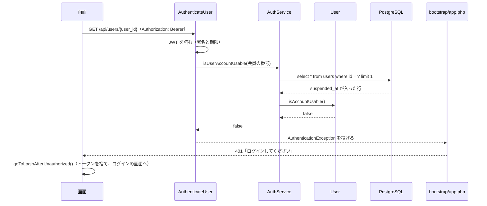

ホームの画面は、先に `/api/me` を呼ぶ。`/api/me` は、まだ JWT のコピーを読んでいる（#257 で直す）。期限の切れたトークンでは `/api/me` が 500 を返し、`public_id` が分からないまま `/api/users/undefined` を呼ぶ。そこで `AuthenticateUser` が、URL を見る前に 401 を返すので、ログインの画面に移る。移る動きは合っているが、`/api/me` の 500 がエラーのログに1行残る。

### 名前

#### `User::isAccountUsable()`

- ほかの候補：`isUsable()`
- 選ばなかった理由：何が使えるのかが分からない（人が決めた）

#### `AuthService::isUserAccountUsable()`

- ほかの候補：`canUseApi()`・`isAccountUsableById()`・`hasUsableAccount()`
- 選ばなかった理由
  - `canUseApi`：層の言葉（API）が入る
  - `ById`：引数の形を名前に出すだけ
  - `hasUsableAccount`：「AuthService が持つか」と読めてしまう（Swift の指針。`architecture-backend.md` の3章）

#### `AuthenticateUser`

- ほかの候補：`AuthenticateUserMiddleware`
- 選ばなかった理由：Laravel の `make:middleware` の例に合わせ、種類の名前を付けない（3章「クラスの名前」）

#### `loginUserId()`

- ほかの候補：`currentUserId()`
- 選ばなかった理由：用語集の「会員の番号の名前」の `login_user_id`・`$loginUserId` とそろえる

### 依存の向き

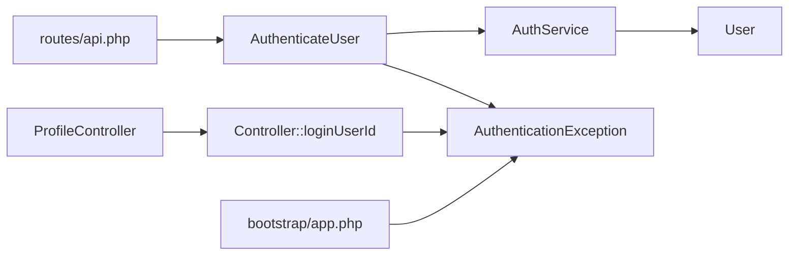

Middleware は Model を使わない（`tests/Arch/LayersTest.php` の「Request と Middleware は、Model・DB を使わない」）。Service は HTTP を使わない（同じく「Service は、Http を使わない」）。

### レガシー版との違い

| | レガシー版 | この PR のあと |
| --- | --- | --- |
| トークンを読む所 | 17ファイル・29か所にコピー | プロフィールの2本は `AuthenticateUser` の1か所。残りの15の Controller は #257 |
| 止めた会員 | ログインの API だけが見る。前のトークンは30日使える | プロフィールの API は、次のリクエストから 401 |
| 壊れたトークン | 500（エラーのログに残る） | 401（エラーのログに出さない） |
| ログインしていない人 | 相手のプロフィールが見られる・書き換えられる | 401 |

### 直した課題と、現場での意味

課題と、決めたことは `05-problems.md` の「#243」の節。

- だれが困らなくなるか：通報した会員（止めてもらった相手から、プロフィールを見られない）と、運営（壊れたトークンの 500 が、エラーのログに残らない）
- どう気づけるようになるか：止めた会員の前のトークンを確かめるテストが、Middleware の確かめの行を消すと落ちる
- 数字：プロフィールの API の、ログインなし・壊れたトークン・止めた会員が、200 と 500 から、どれも 401 になった

### 次の改善の候補

#### 残りの15の Controller を Middleware に置き換える

- 今どうなっているか：`/api/me` やいいねの一覧は、壊れたトークンで 500・止めた会員で 200
- 直すとどうなるか：全部の API で同じ 401 になる
- 気づいた所：#257

#### `ProfileService::showProfile` の `?int $viewerId`

- 今どうなっているか：ログインが要るようになり、もう null は来ない
- 直すとどうなるか：`int` にし、見る人がいないときの分かれ道を消す
- 気づいた所：この PR

#### 会員の状態を enum で持つ

- 今どうなっているか：退会・停止・強制退会を、3つの日時の列で持つ
- 直すとどうなるか：状態が1つの値で決まり、真偽のメソッドはそこから作る
- 気づいた所：真偽の名前の調べもの（#261）

### 説明の練習

#### 1回目：止めた会員からメッセージが届く（2026-11-20）

リーダーが、取り込んだ次の日の運営の相談の場面で聞いた：「管理画面で止めた会員から、まだメッセージが届くと、通報した会員に言われた」。

##### 問い1：この PR のあとでも、なぜ止めた会員がメッセージを送れるか

- 人の答え：メッセージの API に Middleware が付いていないから
- 結果：合っている
  - `MessageController` が自分で JWT を読み、署名と期限しか見ない

##### 問い2：まず、どのファイルのどこを見るか

- 人の答え：`routes/api.php`
- 結果：合っている
  - `user.authenticate` が付いているのは、プロフィールの2本だけ

##### 問い3：メッセージの API に Middleware を付けるだけで、止めた会員は送れなくなるか。Controller の中の JWT のコードはどうなるか

- 人の答え：止められない。JWT があるかで判断する
- 結果：ずれていた。付けるだけで止まる
  - Middleware は Controller より先に動き、止めた会員なら 401 を投げて終わる（Controller まで届かない）
  - Controller の中の JWT のコードは、使える会員のときにもう一度動くだけで、残ったままになる
  - それを消して `loginUserId()` にするのが #257

##### 次にやること

- Middleware と Controller の「動く順番」で考える
- 「止める」（Middleware を付ける）と「読む所を1か所にする」（Controller のコピーを消す）は、別の作業として分けて言う
