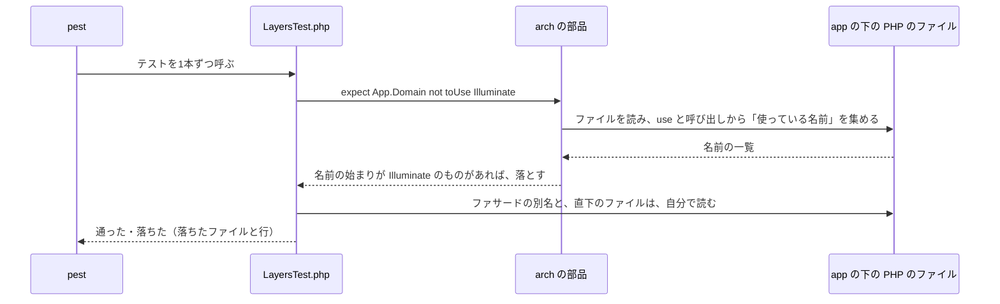
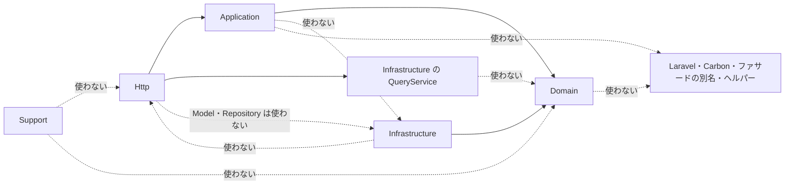

# コードの解説

PR ごとに1節。形は process.md の6章。

## PR #

### ディレクトリの設計

### クラスの責務

### メソッドの表

| メソッド | 入力 | 戻り値 | 副作用 | 失敗のしかた | 呼ぶ所 |
| --- | --- | --- | --- | --- | --- |
| | | | | | |

### 呼び出しの流れ

### 名前・依存の向き

### レガシー版との違い

### 説明の練習

## PR #231（#106 アーキテクチャのテスト。会員の側）

アプリのコードは変えていない。層の決まり（`agents/rules/architecture.md` の2章・3章）を、機械で確かめるテストを足した。クラスもメソッドも足していないので、「クラスの責務」「メソッドの表」は、テストごとの表に読み替える。

### ディレクトリの設計

```text
backend/client/tests/
├── Arch/
│   └── LayersTest.php   ← 足した。層の決まりを確かめるテスト 15本
├── Feature/             （前から。DB と API をまたぐテスト）
├── Unit/                （前から。まだ空）
└── Support/             （前から。テストの部品。#104）
```

- 置き場の理由：`architecture.md` の8章が、`tests/Arch/LayersTest.php` と決めている。`phpunit.xml` の `Arch` の組（`tests/Arch`）は、前からあった
- ほかに置ける場所と、置かなかった理由
  - `tests/Unit`：DB を使わないので、置けなくはない。ただ、Unit は「業務の決まり（Domain）を、値を渡して確かめる」場所にしたい。層の決まりは、アプリの振る舞いではなく、コードの形の確かめなので、分けた
  - Larastan の独自のルール：書けるが、ルールを PHP のクラスで書くことになり、読むのも直すのも重い。Pest は、もう入っている
  - deptrac：依存の図が出るが、道具が1つ増える（チケット #106 の「候補の比較」で、採らなかった）
- `Arch` の組は、`Feature` と違い、`RefreshDatabase` を使わない（`tests/Pest.php` で、DB の準備を付けているのは `Feature` だけ）。DB がなくても流せる

### テストごとの表（「クラスの責務」「メソッドの表」の代わり）

決まりを1行ずつ。「どう確かめるか」は2通りある：`arch()`（Pest の部品。PHP のファイルを読んで、だれがだれを使うかを調べる）と、ファイルの文字や名前を自分で読むテスト。

| テスト | 何を確かめるか | どう確かめるか | 落ちる例 |
| --- | --- | --- | --- |
| Domain はほかの層・Laravel・Carbon・基盤を使わない | Domain は、PHP の標準だけ | `arch()` | Domain に `use Illuminate\Support\Facades\DB;` |
| Application は Http・Infrastructure・Laravel・Carbon・基盤を使わない | UseCase は、Domain だけを使う | `arch()` | UseCase に `use App\Infrastructure\Repositories\…;` |
| Domain／Application は Laravel のヘルパー関数を使わない（2本） | `now()`・`config()`・`resolve()` など | `arch()` | Domain に `now()` |
| Domain と Application は、ファサードの別名を使わない | `\DB::`・`use DB;`・`use DB as X;`・`use Log, DB;` | ファイルの文字を読む | Domain に `\DB::table(…)` |
| Http が使ってよい Infrastructure は QueryService だけ | 新しい Controller は、Model・Repository を直接使わない | `arch()`。古いコントローラー 19個は外す | 新しい Controller に `use App\Models\User;` |
| app/Http/Controllers の直下には、基底と古いコントローラーだけがある | 直下に、新しいコントローラーを足さない | フォルダのファイルの名前を、一覧と比べる | 直下に `UserControllerV2.php` |
| Infrastructure は UseCase と Http を使わない | Repository は、呼ぶ側を知らない | `arch()` | Repository に `use App\Http\…;` |
| QueryService は Application・Repository・Domain を使わない | 読み取りの道は、書き込みの道と交わらない | `arch()` | QueryService の引数の型が Domain の値オブジェクト |
| Support（基盤）は、層と Model を使わない | 基盤は、機能を知らない | `arch()` | Support に `use App\Models\User;` |
| Domain の interface は Interface で終わる・UseCase は final・UseCase で終わる・QueryService は final（4本） | 名前と `final` | `arch()` | `class LikeUseCase`（`final` がない） |
| 新しい層のファイルは strict_types | `declare(strict_types=1);` | `arch()`。古いコントローラーは外す | `declare` のないファイル |

大事な所の抜き出し（3か所）。

①「まだ移していないもの」の一覧。この一覧が、そのまま移行の残りになる。

```php
const LEGACY_CONTROLLERS = [
    'App\Http\Controllers\AuthController',
    // …（19個）
];
const LEGACY_MODELS = 'App\Models';   // ignoring には渡さない
```

② `ignoring` に渡すのは、古いコントローラーだけ。`App\Models` を渡すと、新しいコードが Model を使っても落ちなくなる（`ignoring` は、「使われる側」の名前も消すため）。

```php
arch('Http が使ってよい Infrastructure は QueryService だけ', function (): void {
    expect('App\Http')
        ->not->toUse([/* … */ LEGACY_MODELS])
        ->ignoring(LEGACY_CONTROLLERS);
});
```

③ ファサードの別名は、`arch()` では確かめられない。ファイルの文字を読む。

```php
// ① \DB:: のように、先頭に \ を付けて呼ぶ形
preg_match_all('/(?<![\w\\\\])\\\\('.$pattern.')\b(?!\\\\)/', $source, $calls);
// ② use で読み込む形。文を1つずつに分けて、名前を比べる
foreach (explode(',', $statement) as $part) {
    $imported = ltrim(trim((string) preg_replace('/\s+as\s+\w+\s*$/i', '', trim($part))), '\\');
    if (in_array($imported, $aliases, true)) { /* 違反 */ }
}
```

### 呼び出しの流れ

リクエストは来ない（アプリを動かさない）。テストを流したときの流れ。SQL は1本も流れない。



### 名前

| 名前 | 理由 | ほかの候補と、選ばなかった理由 |
| --- | --- | --- |
| `LayersTest` | 層（layer）の決まりを確かめる。8章が決めた名前 | `ArchitectureTest`：フォルダの名前（`Arch`）と重なる |
| `LEGACY_CONTROLLERS`・`LEGACY_MODELS` | 「古い」ではなく、「まだ移していない」という意味。移したら消す、が読み取れる | `IGNORED_…`：なぜ外すのかが、名前から分からない |
| `OUTSIDE_LAYERS` | 設計の図（3章）の層の外にあるフォルダ（`App\Mail`・`App\Providers`） | `LEGACY_FOLDERS`：`Providers` は古いものではなく、ずっと残る |
| `LARAVEL_HELPERS` | Laravel のヘルパー関数。Domain と Application で使わないもの | `FORBIDDEN_FUNCTIONS`：Http と Infrastructure では使ってよいので、「禁止」は言いすぎ |
| テストの名前（日本語の文） | 落ちたときに、どの決まりを破ったかが、そのまま読める | 英語の名前：決まりの文（2章の表）と、言葉がずれる |

### 依存の向き

テストが確かめている向き（2章の図）。実線は、使ってよい。点線は、テストが止めている向き。



テストのファイルそのものは、アプリのどのクラスも `use` していない（名前を文字として持つだけ）。使っているのは、Pest と、Laravel の `Facade::defaultAliases()`（別名の一覧を取るため）だけ。

### レガシー版との違い

レガシー版（`legacy-repo`）には、このテストがない（`tests/Arch` は、空のフォルダだった）。層の決まりを確かめる仕組みは、何もなかった。

| | レガシー版 | この PR のあと |
| --- | --- | --- |
| 層の決まり | ない（Controller に、JWT の読み出し・DB の読み書き・判断を、全部書く） | 文書（`architecture.md`）と、テスト 15本 |
| 古いコントローラー | 19個（2026-11-17〜18 に、通報・お知らせなどで増えた） | 19個のまま。一覧（`LEGACY_CONTROLLERS`）に並び、移した分だけ、一覧から消す |
| 新しいコントローラーを足す場所 | `app/Http/Controllers` の直下 | 直下には足せない（テストが落ちる）。業務のまとまりのフォルダに足す |

### 作る途中で分かったこと（8章を直した所）

| 分かったこと | どうやって分かったか | 直し方 |
| --- | --- | --- |
| `expect(関数の一覧)->not->toBeUsedIn(層の一覧)` は、違反があっても通る | Domain に `now()` を置いて流した | 層ごとに `not->toUse(関数の一覧)` |
| `arch('名前')->expect(…)` は、Larastan が指摘する | Larastan を流した（テストのフォルダも対象） | 無名関数の中に書く |
| `arch()` は、名前の始まりで比べる | ライブラリのコードを読んだ（`leaveByNameStart`） | ファサードの別名と、直下のファイルは、完全に一致で比べるテストを別に書いた |
| 最初に書いた正規表現は、`use DB as Database;`・`use Log, DB;` を見逃した | 2回目のレビューで、レビュー役が置いて確かめた | `use` の文を1つずつに分けて、名前を比べる |

どれも、「テストが通った」だけでは分からなかった。新しい層にファイルがないあいだは、当てはまるものがなく、効いていないテストも通る。**違反を置いて、落ちるのを見る**ことで分かった。

### 説明の練習

（これから。人が説明したら、ここと `docs/onboarding/quiz-log.md` に残す）
