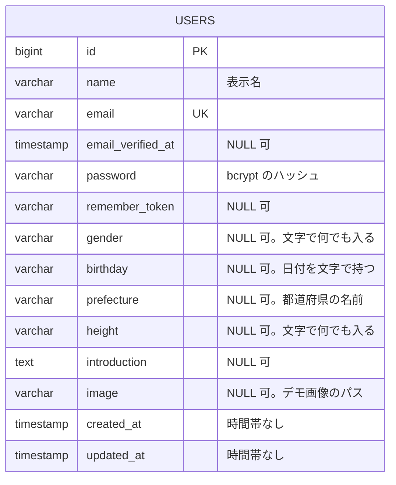

# データモデル

今の表の一覧と ER 図。一歩で表を足したり変えたりしたら、ここを直す（`docs/` は `main` で直して、2本のブランチに取り込む）。

素朴な版（`legacy-repo`）と直した版（`refactored-repo`）で形が違うので、分けて書く。設計の理由は [decisions.md](decisions.md) と、一歩ごとの解説（`explanations/`）に書く。

## 素朴な版（legacy-repo）

### ER 図

### 表の一覧

| 表 | 一歩 | 中身 | 制約 |
| --- | --- | --- | --- |
| `users` | 00（ひな形）・01 | 会員。ログインに使う列と、プロフィールの列を1つの表に持つ | 主キー `id`・`email` の UNIQUE（`users_email_unique`）。プロフィールの列には制約なし |

Laravel のひな形が作った表（この学習では扱わない）：`password_reset_tokens`・`sessions`・`cache`・`cache_locks`・`jobs`・`job_batches`・`failed_jobs`・`personal_access_tokens`（`install:api` が足した Sanctum の表。01b の直した版で使う）。

## 直した版（refactored-repo）

まだない。01 を直したら、次の形にする予定（[01 の解説](../explanations/01-members.html)・D-012・D-013）。

| 表 | 中身 | 主な制約 |
| --- | --- | --- |
| `genders` | 性別のマスタ（男性・女性・その他・回答しない） | 主キー `code`（`smallint`） |
| `prefectures` | 都道府県のマスタ（JIS の都道府県コード 1〜47） | 主キー `code`（`smallint`） |
| `users` | ログインに使うものと、変えない値（性別・生年月日） | `gender_code` → `genders.code` の外部キー・`birthdate` は `date` |
| `profiles` | 相手に見せて、自分で変えるもの | `user_id` が主キー兼外部キー（1対1）・`prefecture_code` → `prefectures.code` の外部キー・表示名の長さの CHECK。身長は型だけ（範囲はアプリ） |
