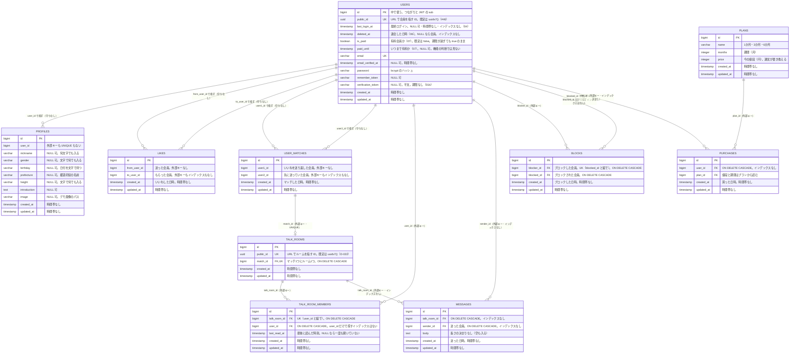

# データモデル

今の表の一覧と ER 図。一歩で表を足したり変えたりしたら、ここを直す（`docs/` は `main` で直して、2本のブランチに取り込む）。

レガシー版（`legacy-repo`）と改善版（`refactored-repo`）で形が違うので、分けて書く。設計の理由は [decisions.md](decisions.md) と、一歩ごとの解説（`explanations/`）に書く。

## レガシー版（legacy-repo）

`users`（アカウント）と `profiles`（その会員についての情報）に分ける（D-015）。分けてはいるが、型は文字のまま・制約なし・1対1 の守りもない。`likes`（02）は会員と会員をつなぐ中間テーブルで、同じ組の UNIQUE だけを持つ。`user_matches`（03）はお互いにいいねした2人の組を1行で持つが、制約もインデックスもない。

01 では初め `users` 1つに全部を持っていたが、#18（PR #19）の新しいマイグレーションで `profiles` を作り、`users` のプロフィールの列と `name` を移して消した。

#46 で、`users` に URL で会員を指すための `public_id`（UUID v7）を足す（D-022。PR #47）。表どうしのつながりと JWT の `sub` は `bigint` の `id` のまま。

05 で、メッセージの表を3つ足す（D-023。#57）。`talk_rooms`（やり取りの場所。マッチしたときに1つ作る）・`talk_room_members`（ルームの中の一人ひとりの状態）・`messages`（中身）。それまでの表と違い、主キー・UNIQUE・外部キーを持つが、インデックスは足さない（PostgreSQL は外部キーの列にインデックスを作らないので、UNIQUE の分しかない）。受け取った人は持たない（参加者のうち、送った人でない人）。

06 で、ブロックの表 `blocks` と、`users` の退会した日時 `deleted_at`（論理削除）を足す（#73）。05 と同じく、主キー・UNIQUE・外部キーを持ち、インデックスは足さない。ブロックしてもマッチやメッセージは消さず、読むときに除く。`User` に `SoftDeletes` は付けないので、退会した人を除くのは、条件を書いたクエリだけ。メールアドレスの UNIQUE はそのままで、退会の API がメールアドレスを書き換えて空ける。

07 で、有料会員を足す（#80）。`users` に有料かどうか（`is_paid`）といつまで有料か（`paid_until`）、プランの表 `plans`（期間と今の値段。3行はマイグレーションで入れる）、購入の記録 `purchases`（どのプランを買ったかだけ）。設計を考えずに「とりあえず使える」形で、機能を使えるかは `is_paid` だけで決める（期限が過ぎても、だれも false に戻さない）。購入の記録は値段と期間を持たないので、プランの値段を変えると、前の記録の値段も変わって見える。主キーと外部キーだけで、インデックスは足さない。

### ER 図

### 表の一覧

| 表 | 一歩 | 中身 | 制約 |
| --- | --- | --- | --- |
| `users` | 00（ひな形）・01・01b・#46・04・06・07 | アカウント（ログインのための情報）・最終ログイン・退会した日時（06。論理削除）・有料会員か（07） | 主キー `id`・`email` の UNIQUE（`users_email_unique`。大文字と小文字は区別する）・`public_id` の UNIQUE（`NOT NULL`・既定は `uuidv7()`。D-022）。`last_login_at` は NULL 可でインデックスなし（desc で並べると、ログインしていない会員が先頭に出る。検索は表を全部読む）。`deleted_at` は NULL 可でインデックスなし。退会してもメールアドレスの UNIQUE はそのまま（退会の API が書き換えて空ける）。`is_paid` は既定 false・`paid_until` は NULL 可（07。どちらもインデックスなし） |
| `profiles` | 01 | その会員についての情報 | 主キー `id` だけ。`user_id` に外部キーも UNIQUE もないので、1人に2つのプロフィール・ない会員を指すプロフィールができる |
| `likes` | 02 | いいね（だれから・だれへ・いつ）。会員と会員をつなぐ中間テーブル | 主キー `id`・`(from_user_id, to_user_id)` の UNIQUE（`likes_from_user_id_to_user_id_unique`）だけ。外部キーがないので、ない会員を指せ、会員を消しても残る。自分から自分も入る。`to_user_id` から探すと表を全部読む |
| `user_matches` | 03 | マッチ（お互いにいいねした2人の組と、いつ）。Model は `UserMatch`（`match` は PHP の予約語） | 主キー `id` だけ。同じ組が2行入り、(A, B) と (B, A) も両方入る。自分とのマッチ・ない会員を指すマッチも入り、会員を消しても残る。自分のマッチを探す `user1_id = ? or user2_id = ?` は表を全部読む |
| `talk_rooms` | 05 | トークルーム（やり取りの場所）。マッチしたときに、いいねの API の中で作る（トランザクションなし） | 主キー `id`・`public_id` の UNIQUE（既定は `uuidv7()`）・`match_id` の UNIQUE と外部キー（`ON DELETE CASCADE`）。03 で2行になった組には、ルームも2つできる |
| `talk_room_members` | 05 | トークルームの参加者（マッチした2人）と、最後に読んだ時刻 | 主キー `id`・`(talk_room_id, user_id)` の UNIQUE・2つの列の外部キー（`ON DELETE CASCADE`）。UNIQUE は `talk_room_id` が先なので、自分のルーム（`user_id = ?`）を探すと表を全部読む |
| `messages` | 05 | メッセージ（ルーム・送った人・本文・いつ）。受け取った人は持たない | 主キー `id`・`talk_room_id` と `sender_id` の外部キー（`ON DELETE CASCADE`）だけ。外部キーの列にインデックスがないので、ルームのメッセージを探すたびに表を全部読み、会員を消すと CASCADE のために表を全部読む。本文の長さの決まりなし |
| `blocks` | 06 | ブロック（だれが・だれを・いつ）。マッチ・メッセージは消さずに、読むときに除く | 主キー `id`・`(blocker_id, blocked_id)` の UNIQUE・2つの列の外部キー（`ON DELETE CASCADE`）。自分で自分をブロックする行も入る。UNIQUE は `blocker_id` が先なので、私をブロックした人（`blocked_id = ?`）を探すと表を全部読む |
| `plans` | 07 | 有料のプラン（期間と今の値段）。1か月 3,980円・3か月 9,800円・6か月 16,800円の3行をマイグレーションで入れる | 主キー `id` だけ。同じ期間が2行入る・値段が0や負の数でも入る |
| `purchases` | 07 | 購入の記録（だれが・どのプランを・いつ） | 主キー `id`・`user_id`（`ON DELETE CASCADE`）と `plan_id` の外部キーだけ。値段と期間を持たないので、プランの値段を変えると前の記録の値段も変わる。`user_id` から探すと表を全部読む |

Laravel のひな形が作った表（この学習では扱わない）：`password_reset_tokens`・`sessions`・`cache`・`cache_locks`・`jobs`・`job_batches`・`failed_jobs`・`personal_access_tokens`（`install:api` が足した Sanctum の表。D-014 で JWT にしたので使わない）。

## Firestore（05c。レガシー版）

手元の Firebase Emulator（`demo-matching`）に置く。正は PostgreSQL のままで、Firestore はやり取りとその表示に要るものだけを持つ（D-008・`explanations/05c-firestore.html`）。ID は PostgreSQL の `users.public_id`（uid）・`talk_rooms.public_id`（ルーム）・`messages.id` をそのまま使う。

| パス | 中身 | 守り |
| --- | --- | --- |
| `users/{uid}` | ドキュメントは置かない（下の受信箱の入れ物だけ） | ― |
| `users/{uid}/rooms/{roomId}` | 自分から見たルーム（受信箱）。`partnerUid`・`lastReadAt`（最後に開いた時刻。まだなら null）だけ | レガシー版のルールは「ログインしていればだれでも読み書きできる」 |
| `rooms/{roomId}` | ルーム。`members`（2人の uid） | 同じ |
| `rooms/{roomId}/messages/{messageId}` | メッセージ。`senderId`・`body`・`createdAt` | 同じ。列の決まりがないので、空の本文も他人の `senderId` も入る |

## 改善版（refactored-repo）

まだない。01・01b・02・03 を直したら、次の形にする予定（[01 の解説](../explanations/01-members.html)・[01b の解説](../explanations/01b-auth.html)・[02 の解説](../explanations/02-likes.html)・[03 の解説](../explanations/03-matches.html)・D-012〜D-015）。

| 表 | 中身 | 主な制約 |
| --- | --- | --- |
| `genders` | 性別のマスタ（男性・女性・その他・回答しない） | 主キー `code`（`smallint`） |
| `prefectures` | 都道府県のマスタ（JIS の都道府県コード 1〜47） | 主キー `code`（`smallint`） |
| `users` | アカウント（メールアドレス・パスワード・確認した時刻）と最終ログイン | メールアドレスは小文字にそろえて UNIQUE・`last_login_at` は NOT NULL（登録した時刻を最初の値にする）・`public_id`（UUID v7。URL で会員を指す ID）の UNIQUE。04 の検索のために `(last_login_at, public_id)` のインデックス |
| `profiles` | その会員についての情報（性別・生年月日・ニックネーム・都道府県・身長・自己紹介・画像） | `user_id` が主キー兼外部キー（1対1）・`gender_code` → `genders.code`・`prefecture_code` → `prefectures.code` の外部キー・`birthdate` は `date`・ニックネームの長さの CHECK。身長は型だけ（範囲はアプリ。D-013） |
| `likes` | いいね（02） | `(from_user_id, to_user_id)` の UNIQUE・2つの列から `users.id` への外部キー（`ON DELETE CASCADE`）・`from_user_id <> to_user_id` の CHECK・`to_user_id` のインデックス |
| `user_matches` | マッチ（03）。1組を1行で持ち、`user1_id` に小さい ID を入れる | `(user1_id, user2_id)` の UNIQUE・`user1_id < user2_id` の CHECK（`user_matches_user1`）・`user2_id` のインデックス・2つの列から `users.id` への外部キー（`ON DELETE CASCADE`） |
| `refresh_tokens` | 取り替え用のトークン（01b） | `token_hash` の UNIQUE（SHA-256）・`user_id` → `users.id` の外部キー・家族の番号・期限・使った時刻・止めた時刻 |
