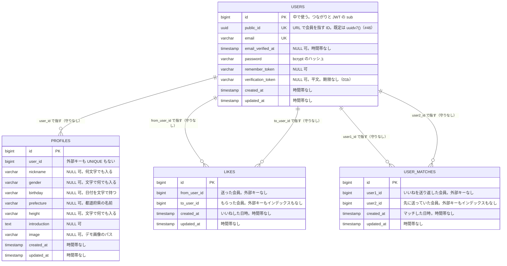

# データモデル

今の表の一覧と ER 図。一歩で表を足したり変えたりしたら、ここを直す（`docs/` は `main` で直して、2本のブランチに取り込む）。

レガシー版（`legacy-repo`）と改善版（`refactored-repo`）で形が違うので、分けて書く。設計の理由は [decisions.md](decisions.md) と、一歩ごとの解説（`explanations/`）に書く。

## レガシー版（legacy-repo）

`users`（アカウント）と `profiles`（その会員についての情報）に分ける（D-015）。分けてはいるが、型は文字のまま・制約なし・1対1 の守りもない。`likes`（02）は会員と会員をつなぐ中間テーブルで、同じ組の UNIQUE だけを持つ。`user_matches`（03）はお互いにいいねした2人の組を1行で持つが、制約もインデックスもない。

01 では初め `users` 1つに全部を持っていたが、#18（PR #19）の新しいマイグレーションで `profiles` を作り、`users` のプロフィールの列と `name` を移して消した。

#46 で、`users` に URL で会員を指すための `public_id`（UUID v7）を足す（D-022。PR #47）。表どうしのつながりと JWT の `sub` は `bigint` の `id` のまま。

### ER 図

### 表の一覧

| 表 | 一歩 | 中身 | 制約 |
| --- | --- | --- | --- |
| `users` | 00（ひな形）・01・01b・#46 | アカウント（ログインのための情報） | 主キー `id`・`email` の UNIQUE（`users_email_unique`。大文字と小文字は区別する）・`public_id` の UNIQUE（`NOT NULL`・既定は `uuidv7()`。D-022） |
| `profiles` | 01 | その会員についての情報 | 主キー `id` だけ。`user_id` に外部キーも UNIQUE もないので、1人に2つのプロフィール・ない会員を指すプロフィールができる |
| `likes` | 02 | いいね（だれから・だれへ・いつ）。会員と会員をつなぐ中間テーブル | 主キー `id`・`(from_user_id, to_user_id)` の UNIQUE（`likes_from_user_id_to_user_id_unique`）だけ。外部キーがないので、ない会員を指せ、会員を消しても残る。自分から自分も入る。`to_user_id` から探すと表を全部読む |
| `user_matches` | 03 | マッチ（お互いにいいねした2人の組と、いつ）。Model は `UserMatch`（`match` は PHP の予約語） | 主キー `id` だけ。同じ組が2行入り、(A, B) と (B, A) も両方入る。自分とのマッチ・ない会員を指すマッチも入り、会員を消しても残る。自分のマッチを探す `user1_id = ? or user2_id = ?` は表を全部読む |

Laravel のひな形が作った表（この学習では扱わない）：`password_reset_tokens`・`sessions`・`cache`・`cache_locks`・`jobs`・`job_batches`・`failed_jobs`・`personal_access_tokens`（`install:api` が足した Sanctum の表。D-014 で JWT にしたので使わない）。

## 改善版（refactored-repo）

まだない。01・01b・02・03 を直したら、次の形にする予定（[01 の解説](../explanations/01-members.html)・[01b の解説](../explanations/01b-auth.html)・[02 の解説](../explanations/02-likes.html)・[03 の解説](../explanations/03-matches.html)・D-012〜D-015）。

| 表 | 中身 | 主な制約 |
| --- | --- | --- |
| `genders` | 性別のマスタ（男性・女性・その他・回答しない） | 主キー `code`（`smallint`） |
| `prefectures` | 都道府県のマスタ（JIS の都道府県コード 1〜47） | 主キー `code`（`smallint`） |
| `users` | アカウント（メールアドレス・パスワード・確認した時刻） | メールアドレスは小文字にそろえて UNIQUE・`public_id`（UUID v7。URL で会員を指す ID）の UNIQUE。04 の検索のために `(last_login_at, public_id)` のインデックス |
| `profiles` | その会員についての情報（性別・生年月日・ニックネーム・都道府県・身長・自己紹介・画像） | `user_id` が主キー兼外部キー（1対1）・`gender_code` → `genders.code`・`prefecture_code` → `prefectures.code` の外部キー・`birthdate` は `date`・ニックネームの長さの CHECK。身長は型だけ（範囲はアプリ。D-013） |
| `likes` | いいね（02） | `(from_user_id, to_user_id)` の UNIQUE・2つの列から `users.id` への外部キー（`ON DELETE CASCADE`）・`from_user_id <> to_user_id` の CHECK・`to_user_id` のインデックス |
| `user_matches` | マッチ（03）。1組を1行で持ち、`user1_id` に小さい ID を入れる | `(user1_id, user2_id)` の UNIQUE・`user1_id < user2_id` の CHECK（`user_matches_user1`）・`user2_id` のインデックス・2つの列から `users.id` への外部キー（`ON DELETE CASCADE`） |
| `refresh_tokens` | 取り替え用のトークン（01b） | `token_hash` の UNIQUE（SHA-256）・`user_id` → `users.id` の外部キー・家族の番号・期限・使った時刻・止めた時刻 |
