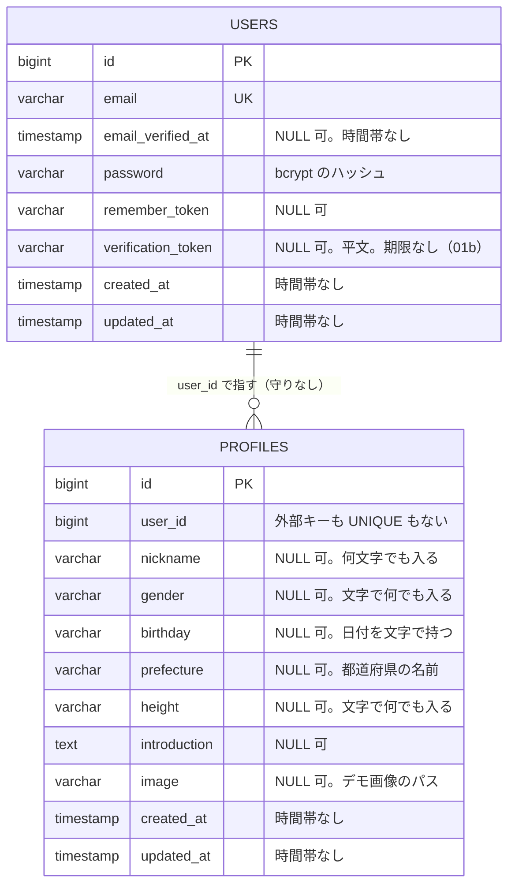

# データモデル

今の表の一覧と ER 図。一歩で表を足したり変えたりしたら、ここを直す（`docs/` は `main` で直して、2本のブランチに取り込む）。

素朴な版（`legacy-repo`）と直した版（`refactored-repo`）で形が違うので、分けて書く。設計の理由は [decisions.md](decisions.md) と、一歩ごとの解説（`explanations/`）に書く。

## 素朴な版（legacy-repo）

`users`（アカウント）と `profiles`（その会員についての情報）に分ける（D-015）。分けてはいるが、型は文字のまま・制約なし・1対1 の守りもない。

> 作り直し中：今の DB は、01 で作った「`users` 1つに全部」の形のまま。新しいマイグレーションで `profiles` を作り、`users` のプロフィールの列と `name` を移して消す。

### ER 図（作り直したあとの形）

### 表の一覧

| 表 | 一歩 | 中身 | 制約 |
| --- | --- | --- | --- |
| `users` | 00（ひな形）・01・01b | アカウント（ログインのための情報） | 主キー `id`・`email` の UNIQUE（`users_email_unique`。大文字と小文字は区別する） |
| `profiles` | 01 | その会員についての情報 | 主キー `id` だけ。`user_id` に外部キーも UNIQUE もないので、1人に2つのプロフィール・ない会員を指すプロフィールができる |

Laravel のひな形が作った表（この学習では扱わない）：`password_reset_tokens`・`sessions`・`cache`・`cache_locks`・`jobs`・`job_batches`・`failed_jobs`・`personal_access_tokens`（`install:api` が足した Sanctum の表。D-014 で JWT にしたので使わない）。

## 直した版（refactored-repo）

まだない。01・01b を直したら、次の形にする予定（[01 の解説](../explanations/01-members.html)・[01b の解説](../explanations/01b-auth.html)・D-012〜D-015）。

| 表 | 中身 | 主な制約 |
| --- | --- | --- |
| `genders` | 性別のマスタ（男性・女性・その他・回答しない） | 主キー `code`（`smallint`） |
| `prefectures` | 都道府県のマスタ（JIS の都道府県コード 1〜47） | 主キー `code`（`smallint`） |
| `users` | アカウント（メールアドレス・パスワード・確認した時刻） | メールアドレスは小文字にそろえて UNIQUE |
| `profiles` | その会員についての情報（性別・生年月日・ニックネーム・都道府県・身長・自己紹介・画像） | `user_id` が主キー兼外部キー（1対1）・`gender_code` → `genders.code`・`prefecture_code` → `prefectures.code` の外部キー・`birthdate` は `date`・ニックネームの長さの CHECK。身長は型だけ（範囲はアプリ。D-013） |
| `refresh_tokens` | 取り替え用のトークン（01b） | `token_hash` の UNIQUE（SHA-256）・`user_id` → `users.id` の外部キー・家族の番号・期限・使った時刻・止めた時刻 |
